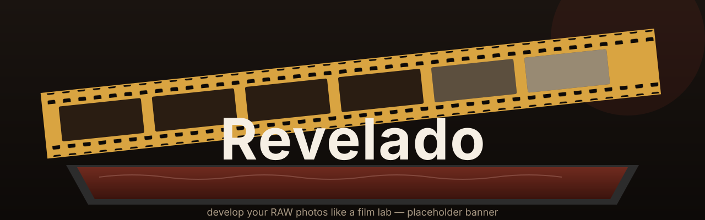
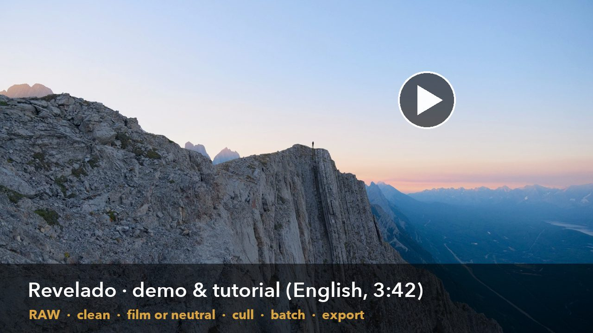
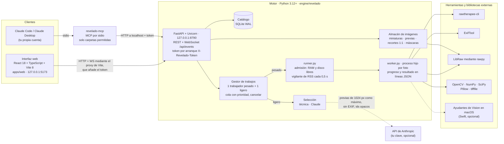
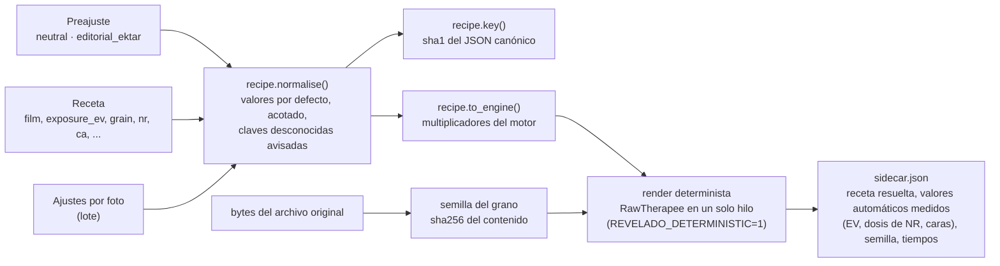

<!-- SPDX-License-Identifier: GPL-3.0-or-later -->
<p align="center">
  
</p>

<h1 align="center">
   Revelado
</h1>

<p align="center"><b>Revela tus RAW como en un laboratorio de película, todo en tu propio ordenador.</b><br>
Emulación física de película, reducción de ruido según el ISO, corrección de aberración cromática, selección local y ayuda de IA opcional, todo guiado por recetas reproducibles.</p>

<p align="center">
  <a href="https://github.com/Blue-Studio-Lab/Revelado/actions/workflows/ci.yml"></a>
  <a href="https://github.com/Blue-Studio-Lab/Revelado/actions/workflows/codeql.yml"></a>
  <a href="https://securityscorecards.dev/viewer/?uri=github.com/Blue-Studio-Lab/Revelado"></a>
  <a href="LICENSE"></a>
  
  
  
  
</p>

<p align="center"><a href="README.md">Read in English</a> · <a href="docs/es/manual/index.md">Manual de usuario</a> · <a href="docs/technical/index.md">Documentación técnica</a> · <a href="docs/ARCHITECTURE.md">Arquitectura</a> · <a href="docs/technical/BENCHMARKS.md">Mediciones</a> · <a href="CONTRIBUTING.md">Contribuir</a></p>

---

<p align="center">
  <a href="https://github.com/Blue-Studio-Lab/Revelado/releases/download/demo-video-v1/revelado-demo-en.mp4"></a>
  <br><sub>Haz clic en la imagen para ver la demo (MP4, 157 MB, en inglés) · <a href="https://github.com/Blue-Studio-Lab/Revelado/releases/tag/demo-video-v1">página de la publicación con los créditos</a></sub>
</p>

## Contenido

1. [Qué es](#qué-es)
2. [Cómo funciona](#cómo-funciona)
3. [Arquitectura](#arquitectura)
4. [Etapas del revelado y tecnología](#etapas-del-revelado-y-tecnología)
5. [Ficha técnica](#ficha-técnica)
6. [Mediciones](#mediciones)
7. [Inicio rápido](#inicio-rápido)
8. [Opciones de IA (todas opcionales)](#opciones-de-ia-todas-opcionales)
9. [Demo](#demo)
10. [Estructura del proyecto](#estructura-del-proyecto)
11. [Mapa de la documentación](#mapa-de-la-documentación)
12. [Hoja de ruta](#hoja-de-ruta)
13. [Contribuir, seguridad y créditos](#contribuir-seguridad-y-créditos)
14. [Licencia y marcas](#licencia-y-marcas)

## Qué es

Revelado es un revelador de fotos RAW libre y de código abierto (GPL-3.0-or-later) con tres piezas:

- un **motor** local (Python, FastAPI) que solo escucha en `127.0.0.1`;
- una **interfaz web** (React + TypeScript + Vite);
- un **servidor MCP** opcional para manejar el motor desde Claude Code o Claude Desktop.

Importa una carpeta, empareja los RAW con sus JPG, muestra máscaras de diagnóstico de ruido y aberración cromática, selecciona las fotos y las revela con un único flujo que tiene dos motores de render: uno neutro y un modelo físico de película.

**Por qué existe.** La mayoría de programas RAW tratan los looks de película como LUT y el ruido como algo que hay que difuminar. Revelado trabaja más como un laboratorio:

- **La película es un proceso físico.** La luz expone tres capas de tinte, cada una con su curva de densidad. Después vienen los efectos entre capas (DIR), el grano vive en la densidad del negativo y al final el negativo se escanea. Sombras, altas luces y grano se comportan como en un negativo real porque salen del mismo modelo. Más en [el modelo de película](docs/technical/film-model.md).
- **El ruido se quita donde realmente está.** La dosis sale del ISO, del empuje de exposición que se va a aplicar y de una medición en la propia imagen. El ruido de color se limpia a fondo; el de luminancia solo hasta un objetivo, para conservar la textura. Más en [reducción de ruido](docs/technical/noise-reduction.md).
- **Cada tipo de aberración cromática tiene su corrección.** La lateral se corrige en el RAW antes del demosaico (sensores Bayer). Las franjas axiales moradas y verdes se llevan hacia el color de su entorno, lo que protege los objetos que de verdad son morados o verdes. Más en [aberración cromática](docs/technical/chromatic-aberration.md).
- **Todo es una receta.** La misma receta sobre el mismo archivo y con la misma versión del motor da los mismos píxeles. Más en [determinismo y recetas](docs/technical/determinism-and-recipes.md).
- **Privado por defecto.** Sin telemetría y sin cuentas. La IA está apagada hasta que tú la activas.

## Cómo funciona

El diagrama sigue el orden real de ejecución de [`library.py`](engine/revelado/library.py), [`runner.py`](engine/revelado/runner.py), [`worker.py`](engine/revelado/worker.py) y [`pipeline/raw.py`](engine/revelado/pipeline/raw.py). Los pasos 1–5 corren en el proceso del motor. Los pasos 6–13 corren en un **proceso hijo distinto para cada foto**.

```mermaid
flowchart TD
  subgraph SESSION["Sesión · proceso del motor"]
    A["1 · Importar y emparejar<br/>búsqueda recursiva, RAW + JPG por carpeta + nombre<br/>catálogo SQLite (WAL)"]
    B["2 · Metadatos y perfil de cámara/objetivo<br/>un proceso de ExifTool por lote de hasta 200 archivos<br/>base de perfiles curada y luego clase genérica"]
    C["3 · Máscaras de diagnóstico<br/>ruido · CA lateral y axial · dominantes de color<br/>LibRaw a media resolución, sin demosaico"]
    D["4 · Selección<br/>técnica, local · Claude, opcional"]
    E["5 · Resolución de la receta<br/>preajuste + receta + ajustes por foto<br/>validar, acotar, avisar de claves ignoradas"]
    A --> B --> C --> D --> E
  end
  subgraph CHILD["Revelado · un proceso hijo por foto · un solo trabajo pesado"]
    F["6 · Análisis de exposición<br/>superpíxel con rawpy, sujeto en el punto AF,<br/>techo de altas luces, EV entre -2 y +7"]
    G["7 · Decodificación RAW y demosaico · rawtherapee-cli<br/>CA lateral en raw, AMaZE, reconstrucción de altas luces,<br/>matriz de cámara a Rec.2020, nitidez de captura,<br/>NR piramidal según ISO + empuje"]
    H["8 · Limpieza en OkLab<br/>ruido medido en la imagen, defringe axial,<br/>despeckle, NL-means de luma hasta el objetivo, NR de croma guiada"]
    I["9 · Distorsión del objetivo<br/>coeficientes embebidos de Sony, Lanczos4"]
    J[("base lineal Rec.2020<br/>en media precisión")]
    K{"10 · Limpieza de cabello<br/>experimental, apagada por defecto,<br/>solo macOS, puerta de seguridad"}
    L["11 · Render: película o neutro<br/>curvas de densidad, color, retoque,<br/>nitidez, grano, codificación sRGB"]
    M["12 · EXIF del original<br/>sin GPS ni miniatura"]
    N["13 · Encuadre: off, suggest o apply<br/>misma geometría para JPG, web y TIFF16"]
    O["Verificación y entrega atómica<br/>full.jpg · web.jpg · full.tif · sidecar.json"]
    F --> G --> H --> I --> J --> K --> L --> M --> N --> O
  end
  E --> F
  E -. "develop_source = jpg<br/>(solo si se elige)" .-> JPG["JPG de cámara<br/>linealizado a Rec.2020"]
  JPG -.-> J
  O --> P["14 · Exportar<br/>JPG q97 4:4:4 o TIFF de 16 bits, ICC sRGB,<br/>nunca sobrescribe ni escribe en la carpeta de originales"]
```



Notas sobre el orden:

- La corrección de CA lateral, el demosaico y la primera pasada de ruido ocurren **dentro de una sola ejecución de RawTherapee** (paso 7), porque la CA lateral se tiene que corregir sobre el mosaico RAW.
- El defringe axial (paso 8) va **antes** de la NR de croma, para que las franjas no se extiendan en halos más anchos.
- El grano se añade al final del render (paso 11), después del retoque y la nitidez, para que sea uniforme en piel y fondo.
- El encuadre (paso 13) trabaja sobre las salidas ya codificadas. El TIFF de 16 bits recibe el mismo giro y recorte, remuestreado con Lanczos en 16 bits.

## Arquitectura



**Modelo de procesos.** El motor ejecuta **un solo trabajo pesado a la vez** (muestra, lote o exportación) junto a un trabajo ligero (selección). Una muestra se adelanta a los trabajos pesados que siguen en cola, pero nunca interrumpe el trabajo en curso: si ya hay un lote revelándose, la muestra espera a que termine. Cada foto se revela en un subproceso de Python nuevo, así que al terminar se libera toda la memoria a resolución completa. Antes de empezar se comprueba el disco libre y la RAM disponible. Mientras trabaja, un vigilante suma la RSS de todo el árbol de procesos (Python + `rawtherapee-cli`) cada 0,5 s y lo detiene si pasa del límite (`E_MEM_GUARD`). Un fallo se registra y el lote continúa. Más en [memoria y planificación](docs/technical/memory-scheduling.md).

**Modelo de seguridad.** El motor se niega a escuchar en algo que no sea `localhost`. Todas las rutas, salvo la aplicación web estática, piden un token aleatorio que se crea en cada arranque y se guarda con permisos 0600. CORS solo acepta orígenes locales. El proceso hijo del revelado nunca recibe `ANTHROPIC_API_KEY`. Ver [SECURITY.md](SECURITY.md).

### La receta como código

Una receta es un documento plano de 13 claves: JSON en la API y YAML plano en el editor del cuarto oscuro. Es la única entrada que cambia los píxeles.



La semilla sale del **contenido** del archivo: renombrarlo no cambia nada y el mismo RAW siempre recibe el mismo grano. Los valores automáticos medidos se guardan en el sidecar, así la imagen se puede reproducir más tarde. Descripción completa en [determinismo y recetas](docs/technical/determinism-and-recipes.md).

## Etapas del revelado y tecnología

| # | Etapa | Qué hace | Tecnología | Parámetros clave (por defecto) | Código |
|---|---|---|---|---|---|
| 1 | Importar y emparejar | Búsqueda recursiva; empareja RAW + JPG por carpeta relativa (sin carpetas de formato como `JPG/` o `RAW/`) + nombre; salta las carpetas que empiezan por `.` o `_` | Python, SQLite (WAL) | `session_id = sha1(carpeta)[:12]`, `photo_id = sha1(sesión + nombre)[:16]` | [`library.py`](engine/revelado/library.py), [`catalog.py`](engine/revelado/catalog.py) |
| 2 | Metadatos | Un proceso de ExifTool por archivo de argumentos de hasta 200 rutas, salida JSON, con notas del fabricante; números de serie con hash; GPS y propietario nunca se piden | ExifTool | `-j`, etiquetas numéricas | [`metadata.py`](engine/revelado/metadata.py) |
| 3 | Perfil de cámara y objetivo | Base de datos curada (modelo exacto o alias) y después clase genérica por formato de sensor o apertura máxima; cada campo indica su fuente | Datos JSON (CC BY-SA 4.0) | `noise_stops = log2(ISO/100) + max(0, ev − 1.5)` | [`profiles/`](engine/revelado/profiles/__init__.py) |
| 4 | Previas y máscaras de diagnóstico | Imagen LibRaw a media resolución (sin demosaico, sin NR de cámara); máscaras de ruido, CA lateral/axial y dominantes con colores aptos para daltónicos | rawpy/LibRaw, OpenCV, NumPy | luma mediana normalizada a 0,18 (ganancia ×0,25–×16); cividis + Okabe-Ito | [`diagnostics.py`](engine/revelado/diagnostics.py), [`imaging.py`](engine/revelado/imaging.py) |
| 5 | Selección técnica | Caras y ojos, nitidez en la cara, en el punto AF y en todo el cuadro, exposición, ráfagas; puntuación y quedarse / quizá / descartar | OpenCV YuNet o Haar; Vision de macOS opcional | ojos cerrados si la proporción < 0,17; ráfaga si < 2,5 s; puntuación = 55 % nitidez + 20 % exposición + 15 % ojos + 10 % sujeto | [`cull/technical.py`](engine/revelado/cull/technical.py), [`pipeline/faces.py`](engine/revelado/pipeline/faces.py) |
| 6 | Selección con IA (opcional) | Dos fases: un prefiltro sobre todas las fotos y luego una clasificación de finalistas; salida JSON estructurada | SDK de Anthropic, Pydantic | fase 1 ≤ 512 px; fase 2 ≤ 1024 px + un recorte de cara ≤ 448 px | [`cull/claude.py`](engine/revelado/cull/claude.py) |
| 7 | Resolución de la receta | Valida y acota la receta, combina preajustes y ajustes por foto, avisa de las claves ignoradas | Python | 13 claves; preajuste por defecto `neutral` | [`recipe.py`](engine/revelado/recipe.py) |
| 8 | Admisión y aislamiento | Espera RAM libre, comprueba el disco, lanza el hijo y vigila la RSS del árbol de procesos | psutil, subprocess | límite de RSS 9 GB; ≥ 3,5 GB de RAM disponible; ≥ 6 GB de disco libre (todo configurable) | [`runner.py`](engine/revelado/runner.py), [`jobs.py`](engine/revelado/jobs.py) |
| 9 | Análisis de exposición | EV sugerido a partir de una clave ponderada al centro y del sujeto en el punto AF, limitado por las altas luces | rawpy, NumPy, OpenCV | clave 0,16 (global) / 0,20 (sujeto, peso 60 %); techo de altas luces +4 EV sobre el gris medio; EV ∈ [−2, +7] | [`pipeline/raw.py`](engine/revelado/pipeline/raw.py) `analyze_exposure` |
| 10 | Decodificación RAW y demosaico | CA lateral en raw (auto, 3 iteraciones, evitar desplazamiento de color), AMaZE, reconstrucción de altas luces, balance y matriz de cámara, espacio de trabajo Rec.2020, nitidez de captura por deconvolución, NR piramidal; salida float32 | CLI de RawTherapee con un perfil `.pp3` generado | NR de luma = 6·(stops − 3), máx. 40; croma automática; un hilo en modo determinista | [`pipeline/raw.py`](engine/revelado/pipeline/raw.py) `develop` |
| 11 | Limpieza | Ruido medido en teselas planas (MAD), defringe axial, despeckle, NL-means de luma hasta un objetivo, filtro guiado de croma en dos escalas | OpenCV, NumPy, OkLab | objetivo de σ de luma 0,45 (OkLab ×100); receta `nr` = auto / soft / strong / off | [`pipeline/clean.py`](engine/revelado/pipeline/clean.py) |
| 12 | Distorsión del objetivo | Aplica la curva de distorsión que Sony guarda en el ARW (SubIFD `0x7037`); para otras marcas, de momento ninguna | OpenCV `remap`, Lanczos4 | zoom elegido para que no aparezcan bordes negros | [`pipeline/raw.py`](engine/revelado/pipeline/raw.py) `correct_distortion` |
| 13 | Limpieza de cabello (experimental) | Quita mechones sueltos sobre fondos lisos; se niega si el fondo tiene textura | Vision de macOS (mate de personas, puntos de la cara) | `hair` = off / suave / medio / fuerte; apagado por defecto | [`pipeline/hair.py`](engine/revelado/pipeline/hair.py) |
| 14a | Render · película | Exposición de escena + guardia de altas luces, MTF de la película, halación, sensibilidad de capas, curvas H&D, acopladores DIR, efecto de adyacencia, grano en densidad, curva de copia del escáner y niveles, tintes en OkLCh, mapeo de gamut | NumPy, OpenCV, OkLab | escala espacial relativa a un cuadro de 7008 px; datos de la película en `kodak_ektar_100.json` | [`pipeline/film/ektar.py`](engine/revelado/pipeline/film/ektar.py) |
| 14b | Render · neutro | Exposición, hombro de altas luces que conserva el tono, curva tonal base en OkLab, mapeo de gamut | NumPy, OkLab | rodilla del hombro 0,75; curva en S suave alrededor de L = 0,55 | [`pipeline/film/neutral.py`](engine/revelado/pipeline/film/neutral.py) |
| 15 | Acabado y retoque | NR residual de luma y croma, retoque de piel, granitos, acento del sujeto, nitidez; después grano, dither TPDF y codificación | Filtro guiado de OpenCV, Pillow | `skin_retouch/60`, `blemishes/50`, `accent/40`, `sharpen` | [`ektar.py`](engine/revelado/pipeline/film/ektar.py) `finish`, [`blemish.py`](engine/revelado/pipeline/blemish.py) |
| 16 | EXIF | Copia todas las etiquetas del original, pone Orientation = 1, quita la miniatura y el GPS | ExifTool | — | [`worker.py`](engine/revelado/worker.py) |
| 17 | Encuadre | Endereza inclinaciones reales (0,3–5°) detectadas como líneas LSD; coloca el sujeto en tercios o en líneas φ; evita cortar cabezas (y también manos y articulaciones cuando está disponible la pose de Vision de macOS); mantiene la proporción | OpenCV LSD + saliencia; pose de Vision (macOS, opcional); `jpegtran` opcional | el recorte conserva ≥ 80 % del área | [`pipeline/reframe.py`](engine/revelado/pipeline/reframe.py) |
| 18 | Entrega y exportación | Verifica el JPEG y mueve las salidas de forma atómica; al exportar copia o reduce, incrusta ICC sRGB y EXIF y coloca los archivos sin sobrescribir | Pillow, tifffile, ExifTool | JPG q97 4:4:4; web q95 a 2560 px; TIFF16 (zlib al exportar) | [`worker.py`](engine/revelado/worker.py), [`develop.py`](engine/revelado/develop.py) |

## Ficha técnica

| Concepto | Especificación |
|---|---|
| **Producto** | Revelado 0.2.0-beta.1 (beta): el motor `revelado`, el servidor MCP `revelado-mcp` y la interfaz web comparten versión |
| **Categoría** | Revelador RAW local, emulador de película y herramienta de selección con una API en localhost |
| **Formatos RAW reconocidos** | `.arw .cr2 .cr3 .nef .nrw .dng .raf .orf .rw2 .pef .srw .3fr .iiq .x3f .erf .kdc .mrw .rwl`. La decodificación la hacen RawTherapee y LibRaw, así que la compatibilidad de cámaras depende de esos proyectos. |
| **Formatos RAW probados** (archivos CC0, revelado completo) | Sony ARW (ILCE-7M4, ILME-FX3) · Canon CR2 (EOS 6D) · Canon CR3 (EOS R50) · Nikon NEF (Z 6) · Fujifilm RAF, X-Trans (X-T3). DNG, RW2, ORF y los demás se aceptan, pero **todavía no están cubiertos** por el conjunto de pruebas público. |
| **JPG** | Se empareja con su RAW por carpeta y nombre. Funcionan las carpetas solo RAW y solo JPG. Un JPG solo se revela si la receta pone `develop_source: "jpg"` (sin NR ni CA del RAW, menor calidad). |
| **Demosaico** | AMaZE en sensores Bayer. X-Trans usa el método por defecto de RawTherapee (el perfil de Revelado no lo fija). |
| **Color de trabajo** | **Rec.2020** lineal de escena, D65, sin acotar (valores > 1 permitidos; 1,0 = saturación del canal verde del sensor). Entre etapas se guarda como **TIFF en media precisión (IEEE binary16)** sin comprimir. El trabajo perceptual se hace en **OkLab / OkLCh**. |
| **Salida** | JPEG **sRGB** de 8 bits, q97, 4:4:4, ICC sRGB, dither TPDF · JPEG web q95, lado largo 2560 px · **TIFF de 16 bits** opcional (sRGB; perfil ICC incrustado al exportar) · `sidecar.json` con la receta resuelta |
| **Profundidad de bits** | RawTherapee float32 → base en media precisión → proceso en float32 → salida de 8 o 16 bits |
| **Resolución** | Recorte por defecto completo de la cámara (de LibRaw), sin ampliar. Los efectos de película (grano, MTF, halación) escalan con el cuadro respecto a un lado largo de 7008 px, así el grano mantiene su tamaño relativo a la imagen. El encuadre mantiene la proporción de la cámara y al menos el 80 % del área. |
| **Determinismo** | Mismo archivo + misma receta + misma versión del motor → píxeles idénticos en la misma máquina. Lo comprueban `test_render_is_deterministic` (render idéntico byte a byte, corre en CI) y la prueba pesada `test_determinism_same_recipe_identical_pixels` (revelado RAW completo, se ejecuta en local). RawTherapee corre en un solo hilo mientras `REVELADO_DETERMINISTIC=1` (por defecto). Identidad entre sistemas operativos: **todavía no medida**. |
| **Concurrencia** | 1 trabajador pesado (revelado / exportación) + 1 ligero (selección); un proceso hijo por foto |
| **Memoria** | Admisión: ≥ 3,5 GB de RAM disponible y ≥ 6 GB de disco libre. Límite del vigilante: 9 GB de RSS para todo el árbol de procesos. Todo configurable (`REVELADO_HEAVY_RSS_CAP_GB`, `REVELADO_HEAVY_MIN_AVAILABLE_GB`, `REVELADO_MIN_FREE_DISK_GB`). **Pico medido: 2,8–4,1 GB** (ver [Mediciones](#mediciones)). |
| **Tiempo por foto** | 32,7 MP: **35,4 s** neutro, **63,4 s** editorial Ektar · archivo de ISO alto de 9,6–12 MP: **14,1 s** / **21,4 s** (medido en la máquina indicada en Mediciones; los resultados varían) |
| **Reducción de ruido** | ISO 20000 (Sony ILME-FX3): σ de luma −77,0 %, σ de croma a / b −95,6 % / −97,3 % · ISO 32000 (Canon EOS R50): luma −52,0 %, croma −94,2 % / −92,2 % |
| **Aberración cromática** | CA lateral, desplazamiento del azul en el percentil 90 en el borde del cuadro: 0,122 → 0,087 px (Sony ILCE-7M4), 0,134 → 0,039 px (Nikon Z 6). **No se corrige en X-Trans** (Fujifilm X-T3: 2,692 → 2,692 px). |
| **Correcciones de objetivo** | Distorsión: solo coeficientes embebidos de Sony. Viñeteo: no se corrige. **Lensfun no está integrado** (planificado). |
| **Detección de caras y personas** | Ayudante Vision de macOS (opcional) → OpenCV YuNet (modelo MIT, descarga verificada por sha256) → cascadas Haar de OpenCV. `REVELADO_FACE_BACKEND` elige; `REVELADO_OFFLINE=1` desactiva las descargas. |
| **IA (opcional)** | Apagada por defecto. Selección con `claude-haiku-5-5` (prefiltro, ≤ 512 px) y `claude-opus-5-5` (finalistas, ≤ 1024 px + un recorte de cara ≤ 448 px); se cambian con `REVELADO_CLAUDE_PREFILTER_MODEL` / `REVELADO_CLAUDE_FINALIST_MODEL`. Antes de cada trabajo se muestra el coste estimado. El revelado no usa ningún modelo de IA. |
| **Privacidad** | Local primero, sin telemetría ni cuentas. Con la IA activada solo salen del equipo previas JPEG recodificadas: sin EXIF, sin GPS, sin nombres de archivo ni rutas; las fotos se identifican con ids opacos. Los números de serie se convierten en hash en local. |
| **Interfaces** | API HTTP (28 rutas REST + 1 WebSocket en `127.0.0.1:8790`) · CLI `revelado` (arranca el motor; los comandos de lote están planificados) · servidor MCP con 17 herramientas · plugin de Claude Code (3 skills) · paquete `.mcpb` para Claude Desktop |
| **Plataformas** | macOS, Windows, Linux. Matriz de CI: Ubuntu 24.04, macOS 15 y Windows Server 2025 × Python 3.12 / 3.13 / 3.14. |
| **Requisitos** | Python ≥ 3.12 · Node.js 22.12+ o 24 LTS (CI compila con 22) · RawTherapee ≥ 5.10 para RAW (`rawtherapee-cli`; el perfil está escrito para 5.13 y las mediciones usaron 5.13) · ExifTool · opcionales: `jpegtran`, `swiftc` (ayudantes de Vision en macOS) |
| **Dependencias de Python** | FastAPI, Uvicorn, Pydantic, NumPy, SciPy, OpenCV (contrib), Pillow, rawpy, psutil, tifffile, imagecodecs · opcional `anthropic` |
| **Pila web** | React 18, TypeScript 5, Vite 8, Vitest 5, Playwright |
| **Licencia** | Código: GPL-3.0-or-later · datos de perfiles de cámara y objetivo incluidos: CC BY-SA 4.0 salvo que el archivo diga otra cosa |
| **Límites conocidos** | La limpieza de cabello es experimental y solo funciona en macOS. Una sola película entrenada (inspirada en Ektar). Sin corrección de viñeteo y sin Lensfun. La CA lateral no se corrige en archivos X-Trans. Algunos umbrales (ventanas de tono del defringe, objetivo de NR) se ajustaron con un sensor Sony de formato completo. Revelar un archivo de 33 MP necesita varios GB de RAM. |

## Mediciones

Medido el 17-11-2026 con `scripts/benchmark_quality.py` sobre archivos RAW CC0 de [raw.pixls.us](https://raw.pixls.us) ([fuentes y licencias](engine/tests/data/SOURCES.md)).

**Máquina:** Apple Silicon (serie M), macOS (Darwin arm64), 10 núcleos de CPU, 16 GB de RAM · RawTherapee 5.13 · motor 0.2.0.dev0. **Los resultados varían** según el hardware, el sistema operativo, la versión de RawTherapee y el contenido de la imagen. El informe original está en [`docs/technical/benchmark-results/`](docs/technical/benchmark-results/).

**Reducción de ruido.** Desviación típica en OkLab ×100 sobre los 16 parches de sombras y medios tonos más planos (los mismos parches en las dos pasadas), `nr=off` → `nr=auto`:

| Archivo | ISO | L | a | b | Reducción L / a / b |
|---|---:|---|---|---|---|
| Sony ILME-FX3 (ARW) | 20000 | 3,772 → 0,867 | 0,528 → 0,023 | 0,772 → 0,021 | 77,0 % / 95,6 % / 97,3 % |
| Canon EOS R50 (CR3) | 32000 | 10,826 → 5,197 | 5,531 → 0,319 | 3,530 → 0,274 | 52,0 % / 94,2 % / 92,2 % |

**Aberración cromática.** Desplazamiento de R y B respecto a G (correlación de fase en teselas de 64 px del anillo exterior del cuadro, percentil 90) y energía de franjas en las bandas de borde de alto contraste, `ca=off` → `ca=auto`:

| Archivo | Desplazamiento R p90 (px) | Desplazamiento B p90 (px) | Franjas ×1000 |
|---|---|---|---|
| Sony ILCE-7M4 (ARW, ISO 250) | 0,048 → 0,040 | 0,122 → 0,087 | 19,401 → 18,420 |
| Nikon Z 6 (NEF, ISO 100) | 0,027 → 0,023 | 0,134 → 0,039 | 25,659 → 25,242 |
| Fujifilm X-T3 (RAF X-Trans, ISO 160) | 0,679 → 0,679 | 2,692 → 2,692 | 28,155 → 28,092 |

La fila de la X-T3 muestra que hoy el paso de CA lateral en raw no tiene efecto sobre archivos X-Trans.

**Rendimiento.** Cadena completa por foto, en su propio proceso: revelado, render, JPEG web, TIFF de 16 bits y encuadre (`reframe=apply`). "MP de salida" es el tamaño tras el encuadre. El pico de RSS cubre todo el árbol de procesos (Python + `rawtherapee-cli`).

| Archivo | MP de salida | Preajuste | Exposición | Revelado | Render | Encuadre | **Total** | **Pico RSS** |
|---|---:|---|---:|---:|---:|---:|---:|---:|
| Sony ILCE-7M4 | 32,7 | neutral | 0,50 s | 21,82 s | 8,68 s | 2,38 s | **35,42 s** | **4148 MB** |
| Sony ILCE-7M4 | 32,7 | editorial_ektar | 0,51 s | 25,16 s | 32,49 s | 2,86 s | **63,38 s** | **3563 MB** |
| Sony ILME-FX3 | 9,6 | neutral | 0,31 s | 6,68 s | 2,69 s | 2,56 s | **14,10 s** | **2812 MB** |
| Sony ILME-FX3 | 12,0 | editorial_ektar | 0,30 s | 6,90 s | 10,75 s | 1,71 s | **21,39 s** | **2782 MB** |

El desglose del render por etapas, las definiciones exactas y la relación de cada cifra con la documentación técnica están en [docs/technical/BENCHMARKS.md](docs/technical/BENCHMARKS.md).

**Reproducir** (unos 150 MB de descargas; la pasada completa revela una foto cada vez y tardó unos 5 minutos en la máquina de arriba, sin contar las descargas):

```bash
python scripts/fetch_test_raws.py               # descarga los RAW CC0 en test-data/ y verifica el sha256
python scripts/benchmark_quality.py             # escribe JSON + Markdown en test-data/benchmarks/
python scripts/benchmark_quality.py --only nr   # o bien: ca | perf
```

## Inicio rápido

Necesitas **Python 3.12–3.14**, **Node.js 22 LTS (22.12 o superior) o 24 LTS**, **git** y **[ExifTool](https://exiftool.org)**. Para revelar RAW también necesitas **[RawTherapee](https://rawtherapee.com) 5.10 o superior**, con `rawtherapee-cli` en el `PATH`.

> **Lo más fácil: que lo instale Claude Code.** Pega esto en [Claude Code](https://claude.com/claude-code) (o en otro agente con acceso a tu terminal):
>
> ```text
> Instala Revelado desde https://github.com/Blue-Studio-Lab/Revelado en este equipo y déjalo funcionando.
> 1. Clónalo en ~/Revelado (si ya existe, haz git pull).
> 2. Lee README.es.md y la página de instalación del manual para mi sistema antes de instalar nada; sigue exactamente el "Inicio rápido".
> 3. Comprueba los requisitos y dime qué falta antes de instalar: Python 3.12–3.14, Node.js 20 o superior, git, ExifTool y RawTherapee 5.10 o superior (hace falta para revelar RAW; si falta, enséñame cómo instalar la versión oficial para mi sistema y espera a que te confirme).
> 4. Instala el motor en un entorno virtual de Python y las dependencias de la interfaz, como indica el Inicio rápido.
> 5. Copia engine/.env.example a engine/.env. No pongas ninguna API key por tu cuenta: la IA es opcional.
> 6. Arranca el motor y la interfaz, abre la dirección local y comprueba que /api/health responde ok.
> 7. Ejecuta las pruebas del motor (pytest) y de la interfaz (npm test) y dime el resultado.
> 8. Solo si te lo confirmo: configura el servidor MCP (mcp/README.md) con acceso únicamente a la carpeta de fotos que yo indique.
> No borres ni modifiques nada fuera de ~/Revelado sin preguntarme. Al terminar, dime qué instalaste, qué versiones y cómo arrancarlo y detenerlo.
> ```

<details open><summary><b>macOS</b></summary>

```bash
brew install python@3.13 node exiftool
brew install --cask rawtherapee            # instala rawtherapee-cli
git clone https://github.com/Blue-Studio-Lab/Revelado.git && cd Revelado
python3 -m venv .venv && source .venv/bin/activate
pip install -e "engine[dev]"               # añade ,ai para las funciones opcionales de Claude
revelado                                   # motor en http://127.0.0.1:8790
# en otra terminal:
cd apps/web && npm ci && npm run dev       # interfaz en http://localhost:5173
```
</details>

<details><summary><b>Windows (PowerShell)</b></summary>

```powershell
winget install Python.Python.3.13 OpenJS.NodeJS.LTS OliverBetz.ExifTool RawTherapee.RawTherapee
git clone https://github.com/Blue-Studio-Lab/Revelado.git; cd Revelado
py -3.13 -m venv .venv; .\.venv\Scripts\Activate.ps1
pip install -e "engine[dev]"
revelado
# en otra terminal:
cd apps\web; npm ci; npm run dev
```
Si `rawtherapee-cli.exe` no está en el `PATH`, añade la carpeta de instalación de RawTherapee o pon su ruta completa como `REVELADO_RAWTHERAPEE_CLI` en `engine/.env`.
</details>

<details><summary><b>Linux (Debian/Ubuntu)</b></summary>

```bash
sudo apt install python3 python3-venv libimage-exiftool-perl rawtherapee
# Node.js: el paquete de la distribución es demasiado antiguo (Ubuntu 24.04 trae 18.x). Instala 22 LTS o 24 LTS
# desde https://nodejs.org/es/download (nvm o los binarios oficiales) y comprueba `node -v`.
git clone https://github.com/Blue-Studio-Lab/Revelado.git && cd Revelado
python3 -m venv .venv && . .venv/bin/activate
pip install -e "engine[dev]"
revelado
# en otra terminal:
cd apps/web && npm ci && npm run dev
```
</details>

Abre <http://localhost:5173>, elige una carpeta de fotos y sigue el [manual de usuario](docs/es/manual/index.md). La configuración se toma de variables de entorno o de `engine/.env` (ver [`engine/.env.example`](engine/.env.example)).

Ejecutar las pruebas (sin red, sin datos privados, sin GPU):

```bash
cd engine && python -m pytest -q                           # batería rápida (sin pruebas pesadas)
cd mcp && python -m pytest -q                              # servidor MCP contra un motor simulado
cd apps/web && npm run typecheck && npm test && npm run build
# opcional, de una en una; necesita los RAW CC0 y RawTherapee:
cd engine && python -m pytest -m heavy -k determinism
```

## Opciones de IA (todas opcionales)

Revelado funciona por completo **sin IA**. Importar, diagnosticar, la selección técnica, el cuarto oscuro, el horno y la exportación corren en local.

| Vía | Qué necesitas | Notas |
|---|---|---|
| **Sin IA** | Nada | Es la opción por defecto. No se hace ninguna llamada de red. |
| **Clave de API de Anthropic** | Una clave de la [Consola de Claude](https://platform.claude.com) en `ANTHROPIC_API_KEY` (o en Ajustes de la app), y `pip install -e "engine[ai]"` | Se paga por uso en tu propia cuenta; la app muestra el coste estimado antes de cada trabajo. **Claude Pro no incluye acceso a la API.** Los planes Max, Team y Ultra incluyen créditos API mensuales que se reclaman en la facturación del plan. *Los planes cambian: compruébalo en platform.claude.com.* |
| **MCP (Claude Code / Claude Desktop)** | Claude Code o Claude Desktop, con el motor en marcha | `revelado-mcp` deja que *tu* Claude maneje el motor local: seleccionar, diagnosticar, revelar una muestra, revelar en lote y exportar. El juicio lo hace tu cuenta de Claude, así que Revelado no necesita clave de API. **Plugin de Claude Code:** `/plugin marketplace add Blue-Studio-Lab/Revelado` y después `/plugin install revelado`. **Claude Desktop:** instala el paquete `.mcpb` adjunto a cada versión. Más en [mcp/README.md](mcp/README.md) y en el [manual de MCP](docs/es/manual/mcp.md). Revelado no es un producto de Anthropic: úsalo según sus términos. |

Qué sale de tu equipo si lo activas: previas JPEG reducidas (≤ 1024 px, más un recorte de cara ≤ 448 px para los finalistas) **sin EXIF**, identificadas con ids opacos. Nunca se envían nombres de archivo, rutas, GPS, archivos RAW ni nombres de clientes. Detalles en [SECURITY.md](SECURITY.md) y en [el capítulo de IA del manual](docs/es/manual/ia.md).

## Demo

**[Ver la demo y el tutorial (inglés, 3:42, 1920×1080)](https://github.com/Blue-Studio-Lab/Revelado/releases/download/demo-video-v1/revelado-demo-en.mp4)**: el MP4 va adjunto a la publicación [`demo-video-v1`](https://github.com/Blue-Studio-Lab/Revelado/releases/tag/demo-video-v1), porque GitHub no guarda archivos de más de 100 MB en el repositorio.

Muestra el flujo completo con RAW reales de cámaras Sony, Canon, Panasonic, Nikon y Pentax:
1. Abrir una carpeta; los RAW y los JPG se emparejan.
2. Ver una foto al 100 % con las máscaras de ruido, aberración cromática y sombreado.
3. Hacer la selección técnica.
4. En el cuarto oscuro, revelar una muestra con una receta de película o con la neutra.
5. Seguir el lote en el horno.
6. Exportar.

También incluye dos fotos nocturnas con ISO extremo y un vistazo a lo que hace el motor por dentro. Las cifras que salen en pantalla son las de [Mediciones](#mediciones); los tiempos dependen de la máquina.

**Créditos de los dos ejemplos de ISO alto (CC BY-SA 4.0, modificadas: reveladas con Revelado, receta Neutro):** "Noisy Dam at Night" de Colin Walls (epeeist), [discuss.pixls.us](https://discuss.pixls.us/t/noisy-dam-at-night/42021) · "Last Lunar Eclipse" de Jetze (anky & jetze), [discuss.pixls.us](https://discuss.pixls.us/t/last-lunar-eclipse-how-to-deal-with-the-inevitable-noise/52526) · [licencia](https://creativecommons.org/licenses/by-sa/4.0/). El resto de las fotos son del autor y se muestran con permiso; ninguna es de clientes.

Hay también versión en español y cortes verticales de 1 minuto; las nuevas versiones se irán añadiendo a las publicaciones.


## Estructura del proyecto

```text
Revelado/
├── engine/                  motor en Python: paquete `revelado`, CLI `revelado`, pruebas con pytest
│   ├── revelado/            API, cola de trabajos, biblioteca, selección, flujo de revelado
│   │   ├── api/             app FastAPI: rutas REST, eventos por WebSocket, middleware del token
│   │   ├── pipeline/        revelado RAW, limpieza, render de película y neutro, caras, retoque, cabello, encuadre
│   │   ├── cull/            selección técnica (local) y selección con Claude (opcional)
│   │   ├── profiles/        resolución de perfiles de cámara/objetivo y base de datos inicial (CC BY-SA)
│   │   ├── native/macos/    ayudantes Swift opcionales para Apple Vision
│   │   └── prompts/         prompts versionados de la selección con IA
│   └── tests/               pruebas unitarias, de API y pesadas con RAW; manifiesto de archivos CC0
├── apps/web/                interfaz web: React 18 + TypeScript + Vite (pantallas, estado, textos EN/ES)
├── mcp/                     servidor revelado-mcp, plugin de Claude Code, manifiesto .mcpb, pruebas
├── docs/                    manual de usuario (en/, es/), documentación técnica, arquitectura, recursos
├── scripts/                 descarga de datos de prueba, mediciones, control de privacidad, protección de GitHub
├── .github/                 flujos de CI, CodeQL, seguridad, DCO, Scorecard y publicación; plantillas de issues
└── .claude-plugin/          entrada del marketplace para el plugin de Claude Code
```

## Mapa de la documentación

| Para | Documentos |
|---|---|
| Usuarios | [Manual de usuario (ES)](docs/es/manual/index.md) · [User manual (EN)](docs/en/manual/index.md): instalación, importar, visor, selección, cuarto oscuro, horno, exportar, recetas y CLI, IA, MCP |
| Desarrolladores | [Arquitectura](docs/ARCHITECTURE.md) · [Motor y contrato de la API](engine/README.md) · [Servidor MCP](mcp/README.md) · [Contribuir](CONTRIBUTING.md) |
| Documentación técnica (en inglés, con resumen en español) | [Índice](docs/technical/index.md) · [Reducción de ruido](docs/technical/noise-reduction.md) · [Aberración cromática](docs/technical/chromatic-aberration.md) · [Exposición con perfiles log](docs/technical/exposure-log-profiles.md) · [Modelo de película](docs/technical/film-model.md) · [Retoque](docs/technical/retouch.md) · [Limpieza de cabello](docs/technical/hair.md) · [Encuadre](docs/technical/reframing.md) · [Determinismo y recetas](docs/technical/determinism-and-recipes.md) · [Memoria y planificación](docs/technical/memory-scheduling.md) · [Mediciones](docs/technical/BENCHMARKS.md) |
| Proyecto | [Registro de cambios](CHANGELOG.md) · [Gobierno](GOVERNANCE.md) · [Código de conducta](CODE_OF_CONDUCT.md) · [Política de seguridad](SECURITY.md) · [Autores](AUTHORS.md) · [Cita](CITATION.cff) |

## Hoja de ruta

- **v0.1 (alfa):** la interfaz web y el motor local funcionan de punta a punta desde el código.
- **v0.2 (en desarrollo):** películas entrenadas con tus propios escaneos, blanco y negro, proceso por franjas (≤ 4 GB por trabajo pesado), reintento con poca memoria, más cámaras.
- **v0.3:** instaladores firmados para macOS, Windows y Linux (aplicación de escritorio con Tauri 2, sin servidor de red).
- **v0.4:** retoque guiado, control de calidad, modo Rescate; el servidor MCP y el plugin de Claude Code salen de la vista previa.
- **v1.0:** endurecimiento, Lensfun, otros proveedores de IA, sitio de documentación.

Ver [CHANGELOG.md](CHANGELOG.md) y la [visión general de la arquitectura](docs/ARCHITECTURE.md).

## Contribuir, seguridad y créditos

**Contribuir.** Son bienvenidos los informes de errores, los datos de cámaras y objetivos, la documentación y el código. Empieza por [CONTRIBUTING.md](CONTRIBUTING.md). Las contribuciones usan el **DCO** (`git commit -s`). Por favor, **nunca adjuntes fotos de clientes** en issues ni PR; usa los archivos de prueba CC0.

**Seguridad.** Informa de vulnerabilidades en privado como explica [SECURITY.md](SECURITY.md), nunca en issues públicos.

**Créditos.** **Creado por Jorge Luis Peña Sanchez ([@bluestudiobrooks-gif](https://github.com/bluestudiobrooks-gif)) · Co-creado con Claude (Anthropic).**
Revelado se apoya en
[RawTherapee](https://rawtherapee.com),
[LibRaw](https://www.libraw.org) / [rawpy](https://github.com/letmaik/rawpy),
[ExifTool](https://exiftool.org),
[OpenCV](https://opencv.org),
[NumPy](https://numpy.org),
[SciPy](https://scipy.org),
[FastAPI](https://fastapi.tiangolo.com),
[React](https://react.dev) y
[Vite](https://vite.dev).
OkLab es obra de Björn Ottosson. Los RAW de prueba vienen del archivo comunitario [raw.pixls.us](https://raw.pixls.us) (CC0). Ver [AUTHORS.md](AUTHORS.md).

## Licencia y marcas

Revelado es software libre bajo la **GNU General Public License v3.0 o posterior**; el texto completo está en [LICENSE](LICENSE). Los datos de perfiles de cámara y objetivo incluidos son CC BY-SA 4.0 salvo que el archivo diga otra cosa. Si usas la documentación técnica en investigación, cita [CITATION.cff](CITATION.cff).

**Marcas.** Los nombres de películas (por ejemplo Kodak Ektar) son marcas de sus dueños y solo se usan para describir el aspecto que un perfil aproxima. El perfil inspirado en Ektar es una emulación aproximada derivada de imágenes de referencia públicas y de la hoja técnica publicada; Revelado no tiene relación con Kodak ni cuenta con su aval. Ver [el modelo de película](docs/technical/film-model.md#provenance-of-the-ektar-inspired-profile).
