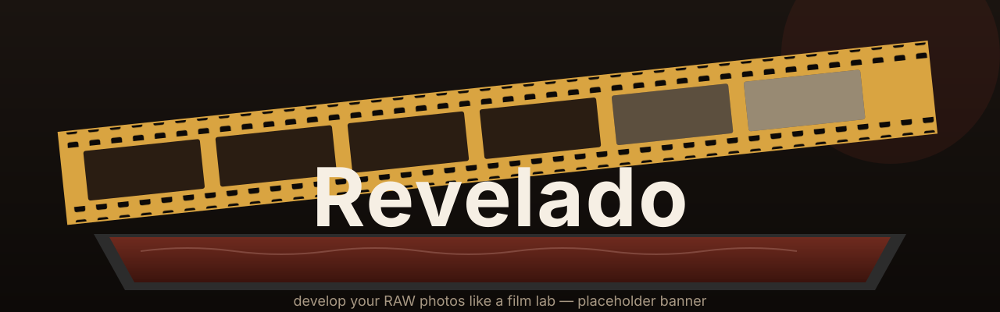
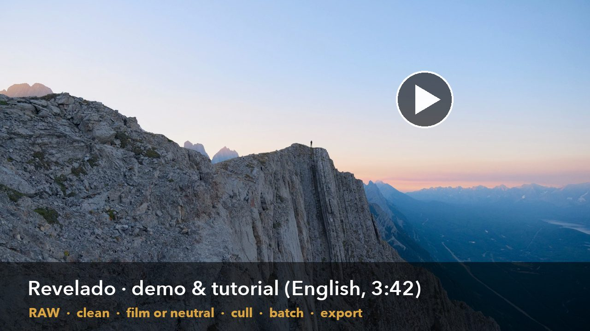
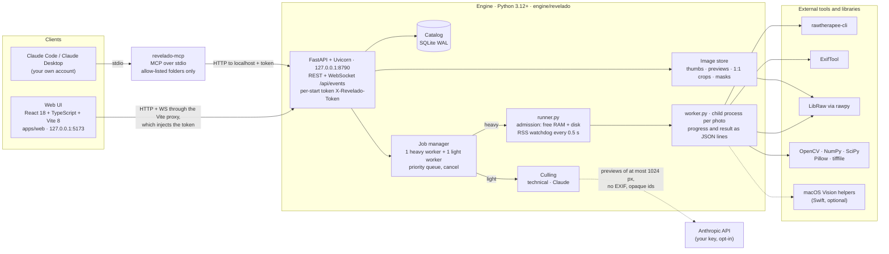
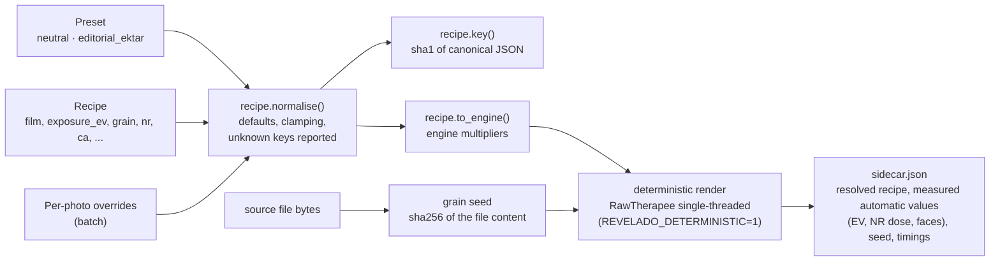

<!-- SPDX-License-Identifier: GPL-3.0-or-later -->
<p align="center">
  
</p>

<h1 align="center">
   Revelado
</h1>

<p align="center"><b>Develop your RAW photos like a film lab, entirely on your own computer.</b><br>
Physical film emulation, ISO-aware noise reduction, chromatic-aberration correction, local culling and optional AI help, all driven by reproducible recipes.</p>

<p align="center">
  <a href="https://github.com/Blue-Studio-Lab/Revelado/actions/workflows/ci.yml"></a>
  <a href="https://github.com/Blue-Studio-Lab/Revelado/actions/workflows/codeql.yml"></a>
  <a href="https://securityscorecards.dev/viewer/?uri=github.com/Blue-Studio-Lab/Revelado"></a>
  <a href="LICENSE"></a>
  
  
  
  
</p>

<p align="center"><a href="README.es.md">Leer en español</a> · <a href="docs/en/manual/index.md">User manual</a> · <a href="docs/technical/index.md">Technical deep-dive</a> · <a href="docs/ARCHITECTURE.md">Architecture</a> · <a href="docs/technical/BENCHMARKS.md">Benchmarks</a> · <a href="CONTRIBUTING.md">Contribute</a></p>

---

<p align="center">
  <a href="https://github.com/Blue-Studio-Lab/Revelado/releases/download/demo-video-v1/revelado-demo-en.mp4"></a>
  <br><sub>Click the image to watch the demo (MP4, 157 MB) · <a href="https://github.com/Blue-Studio-Lab/Revelado/releases/tag/demo-video-v1">release page with credits</a></sub>
</p>

## Contents

1. [What it is](#what-it-is)
2. [How it works](#how-it-works)
3. [Architecture](#architecture)
4. [Development stages and technology](#development-stages-and-technology)
5. [Technical datasheet](#technical-datasheet)
6. [Benchmarks](#benchmarks)
7. [Quick start](#quick-start)
8. [AI options (all optional)](#ai-options-all-optional)
9. [Demo](#demo)
10. [Project structure](#project-structure)
11. [Documentation map](#documentation-map)
12. [Roadmap](#roadmap)
13. [Contributing, security and credits](#contributing-security-and-credits)
14. [License and trademarks](#license-and-trademarks)

## What it is

Revelado is a free, open-source (GPL-3.0-or-later) RAW photo developer with three parts:

- a local **engine** (Python, FastAPI) that listens only on `127.0.0.1`;
- a **web UI** (React + TypeScript + Vite);
- an optional **MCP server** that lets Claude Code or Claude Desktop drive the engine.

It imports a folder, pairs RAW and JPG files, shows diagnostic masks for noise and chromatic aberration, culls the frames, and develops them through one pipeline with two renderers: a neutral one and a physical film model.

**Why it exists.** Most RAW tools treat film looks as LUTs and noise as something to blur away. Revelado works more like a lab:

- **Film is a physical process.** Light exposes three dye layers, each with its own density curve. Interlayer (DIR) effects follow, grain lives in negative density, and then the negative is scanned. Shadows, highlights and grain behave like a real negative because they come out of the same model. See [the film model](docs/technical/film-model.md).
- **Noise is removed where it actually is.** The dose comes from the ISO, the exposure push about to be applied and a measurement on the image itself. Colour noise is cleaned hard; luminance noise is cleaned only down to a target, so texture survives. See [noise reduction](docs/technical/noise-reduction.md).
- **Each kind of chromatic aberration gets its own fix.** Lateral CA is corrected on the RAW before demosaicing (Bayer sensors). Axial purple and green fringes are pulled toward the colour of their surroundings, which protects objects that really are purple or green. See [chromatic aberration](docs/technical/chromatic-aberration.md).
- **Everything is a recipe.** The same recipe on the same file with the same engine version gives the same pixels. See [determinism and recipes](docs/technical/determinism-and-recipes.md).
- **Private by default.** No telemetry and no account. AI is off until you turn it on.

## How it works

The diagram follows the real execution order in [`library.py`](engine/revelado/library.py), [`runner.py`](engine/revelado/runner.py), [`worker.py`](engine/revelado/worker.py) and [`pipeline/raw.py`](engine/revelado/pipeline/raw.py). Steps 1–5 run in the engine process. Steps 6–13 run in a **separate child process for each photo**.

```mermaid
flowchart TD
  subgraph SESSION["Session · engine process"]
    A["1 · Import and pairing<br/>recursive scan, RAW + JPG paired by folder + file stem<br/>SQLite catalog (WAL)"]
    B["2 · Metadata and camera/lens profile<br/>one ExifTool process per batch of up to 200 files<br/>curated profile DB, then generic class"]
    C["3 · Diagnostic masks<br/>noise · lateral and axial CA · colour shading<br/>LibRaw half-size, no demosaic"]
    D["4 · Culling<br/>technical, local · Claude, opt-in"]
    E["5 · Recipe resolution<br/>preset + recipe + per-photo overrides<br/>validate, clamp, report ignored keys"]
    A --> B --> C --> D --> E
  end
  subgraph CHILD["Develop · one child process per photo · single heavy worker"]
    F["6 · Exposure analysis<br/>rawpy superpixel, AF-point subject key,<br/>highlight ceiling, EV clamped to -2 … +7"]
    G["7 · RAW decode and demosaic · rawtherapee-cli<br/>raw lateral CA, AMaZE, highlight reconstruction,<br/>camera matrix to Rec.2020, capture sharpening,<br/>pyramid NR dosed by ISO + push"]
    H["8 · Clean in OkLab<br/>noise measured on the image, axial defringe,<br/>despeckle, luma NL-means to target, chroma guided NR"]
    I["9 · Lens distortion<br/>embedded Sony coefficients, Lanczos4"]
    J[("linear Rec.2020<br/>half-float base")]
    K{"10 · Hair clean-up<br/>experimental, off by default,<br/>macOS only, safety gate"}
    L["11 · Render: film model or neutral<br/>density curves, colour, retouch,<br/>sharpening, grain, sRGB encode"]
    M["12 · EXIF from the source<br/>GPS and thumbnail removed"]
    N["13 · Reframe: off, suggest or apply<br/>same geometry for JPG, web and TIFF16"]
    O["Verify and atomic delivery<br/>full.jpg · web.jpg · full.tif · sidecar.json"]
    F --> G --> H --> I --> J --> K --> L --> M --> N --> O
  end
  E --> F
  E -. "develop_source = jpg<br/>(explicit only)" .-> JPG["camera JPEG<br/>linearised to Rec.2020"]
  JPG -.-> J
  O --> P["14 · Export<br/>JPG q97 4:4:4 or 16-bit TIFF, sRGB ICC,<br/>never overwrites, never into the originals folder"]
```



Notes on the order:

- Lateral CA correction, demosaicing and the first noise pass happen **inside one RawTherapee run** (step 7), because lateral CA has to be fixed on the raw mosaic.
- The axial defringe (step 8) runs **before** chroma NR, so fringes are not smeared into wider halos.
- Grain is added at the end of the render (step 11), after retouch and sharpening, so it is uniform over skin and background.
- Reframing (step 13) works on the encoded outputs. The 16-bit TIFF gets the same rotation and crop, resampled with Lanczos in 16 bit.

## Architecture



**Process model.** The engine runs **one heavy job at a time** (develop sample, batch or export) next to one light job (culling). A sample request jumps ahead of heavy jobs that are still queued, but it never interrupts the running job: if a batch is already running, the sample waits for it to finish. Every photo is developed in a fresh Python subprocess, so all full-resolution buffers are freed when it exits. Before it starts, the runner checks free disk and available RAM. While it runs, a watchdog sums the RSS of the whole process tree (Python + `rawtherapee-cli`) every 0.5 s and kills the tree above the cap (`E_MEM_GUARD`). A failed item is recorded and the batch continues. Details: [memory and scheduling](docs/technical/memory-scheduling.md).

**Security model.** The engine refuses to bind to anything other than `localhost`. Every route except the static web app requires a random token, created at each start and written with mode 0600. CORS only accepts localhost origins. The develop child process never receives `ANTHROPIC_API_KEY`. See [SECURITY.md](SECURITY.md).

### Recipe as code

A recipe is a flat document of 13 keys: JSON over the API, flat YAML in the Develop editor. It is the only input that changes pixels.



The seed comes from the file's **content**, so renaming a file changes nothing and the same RAW always gets the same grain. Measured automatic values are stored in the sidecar, so the image can be reproduced later. Full description: [determinism and recipes](docs/technical/determinism-and-recipes.md).

## Development stages and technology

| # | Stage | What it does | Technology | Key parameters (defaults) | Source |
|---|---|---|---|---|---|
| 1 | Import and pairing | Recursive scan; pairs RAW + JPG by relative folder (format folders such as `JPG/` or `RAW/` removed) + stem; skips folders starting with `.` or `_` | Python, SQLite (WAL) | `session_id = sha1(folder)[:12]`, `photo_id = sha1(session + stem)[:16]` | [`library.py`](engine/revelado/library.py), [`catalog.py`](engine/revelado/catalog.py) |
| 2 | Metadata | One ExifTool process per argument file of up to 200 paths, JSON output, maker notes kept; serial numbers hashed; GPS and owner tags never requested | ExifTool | `-j`, numeric tags | [`metadata.py`](engine/revelado/metadata.py) |
| 3 | Camera and lens profile | Curated seed DB (exact model or alias), then a generic class by sensor format or maximum aperture; every field records its source | JSON data (CC BY-SA 4.0) | `noise_stops = log2(ISO/100) + max(0, ev − 1.5)` | [`profiles/`](engine/revelado/profiles/__init__.py) |
| 4 | Previews and diagnostic masks | Half-size LibRaw image (no demosaic, no in-camera NR); noise, lateral/axial CA and colour-shading overlays in colour-blind-safe maps | rawpy/LibRaw, OpenCV, NumPy | median luma normalised to 0.18 (gain ×0.25–×16); cividis + Okabe-Ito | [`diagnostics.py`](engine/revelado/diagnostics.py), [`imaging.py`](engine/revelado/imaging.py) |
| 5 | Technical cull | Faces and eyes, sharpness at the face, the AF point and the whole frame, exposure, bursts; score and keep / maybe / reject | OpenCV YuNet or Haar; macOS Vision optional | eyes closed if aspect ratio < 0.17; burst gap < 2.5 s; score = 55 % sharpness + 20 % exposure + 15 % eyes + 10 % subject | [`cull/technical.py`](engine/revelado/cull/technical.py), [`pipeline/faces.py`](engine/revelado/pipeline/faces.py) |
| 6 | AI cull (opt-in) | Two stages: a prefilter over every frame, then a ranking of the finalists; structured JSON output | Anthropic SDK, Pydantic | stage 1 ≤ 512 px; stage 2 ≤ 1024 px + one face crop ≤ 448 px | [`cull/claude.py`](engine/revelado/cull/claude.py) |
| 7 | Recipe resolution | Validates and clamps the recipe, merges presets and overrides, reports ignored keys | Python | 13 keys; default preset `neutral` | [`recipe.py`](engine/revelado/recipe.py) |
| 8 | Admission and isolation | Waits for free RAM, checks disk, starts the child, watches the RSS of the process tree | psutil, subprocess | RSS cap 9 GB; ≥ 3.5 GB available RAM; ≥ 6 GB free disk (all configurable) | [`runner.py`](engine/revelado/runner.py), [`jobs.py`](engine/revelado/jobs.py) |
| 9 | Exposure analysis | Suggested EV from a centre-weighted key and the AF-point subject, capped by the highlights | rawpy, NumPy, OpenCV | key 0.16 (global) / 0.20 (subject, weight 60 %); highlight ceiling +4 EV over mid-grey; EV ∈ [−2, +7] | [`pipeline/raw.py`](engine/revelado/pipeline/raw.py) `analyze_exposure` |
| 10 | RAW decode and demosaic | Raw lateral CA (auto, 3 iterations, avoid colour shift), AMaZE, highlight reconstruction, camera WB + matrix, Rec.2020 working space, deconvolution capture sharpening, pyramid NR; float32 output | RawTherapee CLI with a generated `.pp3` profile | luma NR = 6·(stops − 3), max 40; chroma automatic; one thread when deterministic | [`pipeline/raw.py`](engine/revelado/pipeline/raw.py) `develop` |
| 11 | Clean | Noise measured on flat tiles (MAD), axial defringe, despeckle, luma NL-means to a target, two-scale chroma guided filter | OpenCV, NumPy, OkLab | luma target σ 0.45 (OkLab ×100); recipe `nr` = auto / soft / strong / off | [`pipeline/clean.py`](engine/revelado/pipeline/clean.py) |
| 12 | Lens distortion | Applies the distortion curve that Sony embeds in the ARW (SubIFD `0x7037`); no correction for other makes yet | OpenCV `remap`, Lanczos4 | zoom chosen so no black borders appear | [`pipeline/raw.py`](engine/revelado/pipeline/raw.py) `correct_distortion` |
| 13 | Hair clean-up (experimental) | Removes stray strands over smooth backgrounds; refuses when the background is textured | macOS Vision (person matte, face landmarks) | `hair` = off / suave / medio / fuerte; off by default | [`pipeline/hair.py`](engine/revelado/pipeline/hair.py) |
| 14a | Render · film | Scene exposure + highlight guard, film MTF, halation, layer sensitivity, H&D curves, DIR couplers, adjacency effect, grain in density, scanner print curve and levels, OkLCh tints, gamut mapping | NumPy, OpenCV, OkLab | spatial scale relative to a 7008 px frame; stock data in `kodak_ektar_100.json` | [`pipeline/film/ektar.py`](engine/revelado/pipeline/film/ektar.py) |
| 14b | Render · neutral | Exposure, hue-preserving highlight shoulder, OkLab base tone curve, gamut mapping | NumPy, OkLab | shoulder knee 0.75; gentle S-curve around L = 0.55 | [`pipeline/film/neutral.py`](engine/revelado/pipeline/film/neutral.py) |
| 15 | Finishing and retouch | Residual luma/chroma NR, skin retouch, blemish healing, subject accent, sharpening; then grain, TPDF dither and encoding | OpenCV guided filter, Pillow | `skin_retouch/60`, `blemishes/50`, `accent/40`, `sharpen` | [`ektar.py`](engine/revelado/pipeline/film/ektar.py) `finish`, [`blemish.py`](engine/revelado/pipeline/blemish.py) |
| 16 | EXIF | Copies all tags from the source, sets Orientation = 1, drops the embedded thumbnail, strips GPS | ExifTool | — | [`worker.py`](engine/revelado/worker.py) |
| 17 | Reframe | Straightens real tilts (0.3–5°) found as LSD lines; puts the subject on thirds or φ lines; avoids cutting heads (hands and joints too when the macOS Vision pose is available); keeps the aspect ratio | OpenCV LSD + saliency; Vision pose (macOS, optional); `jpegtran` optional | the crop keeps ≥ 80 % of the area | [`pipeline/reframe.py`](engine/revelado/pipeline/reframe.py) |
| 18 | Delivery and export | Verifies the JPEG and moves outputs atomically; export copies or resizes, embeds sRGB ICC and EXIF, and places files without overwriting | Pillow, tifffile, ExifTool | JPG q97 4:4:4; web q95 at 2560 px; TIFF16 (zlib on export) | [`worker.py`](engine/revelado/worker.py), [`develop.py`](engine/revelado/develop.py) |

## Technical datasheet

| Item | Specification |
|---|---|
| **Product** | Revelado 0.2.0-beta.1 (beta): engine `revelado`, MCP server `revelado-mcp` and web UI share the version |
| **Category** | Local RAW developer, film emulator and culling tool with a localhost API |
| **RAW formats recognised** | `.arw .cr2 .cr3 .nef .nrw .dng .raf .orf .rw2 .pef .srw .3fr .iiq .x3f .erf .kdc .mrw .rwl`. Decoding is done by RawTherapee and LibRaw, so camera support follows those projects. |
| **RAW formats tested** (CC0 files, full develop) | Sony ARW (ILCE-7M4, ILME-FX3) · Canon CR2 (EOS 6D) · Canon CR3 (EOS R50) · Nikon NEF (Z 6) · Fujifilm RAF, X-Trans (X-T3). DNG, RW2, ORF and the other formats are accepted but **not yet covered** by the public test set. |
| **JPG** | Paired with its RAW by folder and stem. RAW-only and JPG-only folders work. A JPG is developed only when the recipe sets `develop_source: "jpg"` (no RAW NR or CA, lower quality). |
| **Demosaic** | AMaZE for Bayer sensors. X-Trans uses RawTherapee's default X-Trans method (Revelado's profile does not set it). |
| **Working colour** | Scene-linear **Rec.2020**, D65, unbounded (values > 1 allowed; 1.0 = green-channel sensor saturation). Stored between stages as an uncompressed **half-float (IEEE binary16) TIFF**. Perceptual work in **OkLab / OkLCh**. |
| **Output** | **sRGB** 8-bit JPEG, q97, 4:4:4, sRGB ICC, TPDF dither · web JPEG q95, long side 2560 px · optional **16-bit TIFF** (sRGB; ICC profile embedded on export) · `sidecar.json` with the resolved recipe |
| **Bit depth** | RawTherapee float32 → half-float base → float32 processing → 8-bit or 16-bit output |
| **Resolution** | Full camera default crop (from LibRaw), no upscaling. Film effects (grain, MTF, halation) scale with the frame relative to a 7008 px long side, so grain keeps its size relative to the picture. Reframing keeps the camera aspect ratio and at least 80 % of the area. |
| **Determinism** | Same file + same recipe + same engine version → identical pixels on the same machine. Checked by `test_render_is_deterministic` (byte-identical render, runs in CI) and by the heavy test `test_determinism_same_recipe_identical_pixels` (full RAW develop, run locally). RawTherapee runs single-threaded while `REVELADO_DETERMINISTIC=1` (the default). Identity across operating systems: **not yet measured**. |
| **Concurrency** | 1 heavy worker (develop / export) + 1 light worker (culling); one child process per photo |
| **Memory** | Admission: ≥ 3.5 GB available RAM and ≥ 6 GB free disk. Watchdog cap: 9 GB RSS for the whole process tree. All configurable (`REVELADO_HEAVY_RSS_CAP_GB`, `REVELADO_HEAVY_MIN_AVAILABLE_GB`, `REVELADO_MIN_FREE_DISK_GB`). **Measured peak: 2.8–4.1 GB** (see [Benchmarks](#benchmarks)). |
| **Time per photo** | 32.7 MP: **35.4 s** neutral, **63.4 s** editorial Ektar · high-ISO 9.6–12 MP file: **14.1 s** / **21.4 s** (measured on the machine listed under Benchmarks; results vary) |
| **Noise reduction** | ISO 20000 (Sony ILME-FX3): luma σ −77.0 %, chroma a / b σ −95.6 % / −97.3 % · ISO 32000 (Canon EOS R50): luma −52.0 %, chroma −94.2 % / −92.2 % |
| **Chromatic aberration** | Lateral CA, 90th-percentile blue shift at the frame edge: 0.122 → 0.087 px (Sony ILCE-7M4), 0.134 → 0.039 px (Nikon Z 6). **Not corrected on X-Trans** (Fujifilm X-T3: 2.692 → 2.692 px). |
| **Lens corrections** | Distortion: Sony embedded coefficients only. Vignetting: not corrected. **Lensfun is not integrated** (planned). |
| **Face / person detection** | macOS Vision helper (optional) → OpenCV YuNet (MIT model, sha256-pinned download) → OpenCV Haar cascades. `REVELADO_FACE_BACKEND` selects; `REVELADO_OFFLINE=1` disables downloads. |
| **AI (optional)** | Off by default. Claude cull with `claude-haiku-5-5` (prefilter, ≤ 512 px) and `claude-opus-5-5` (finalists, ≤ 1024 px + one face crop ≤ 448 px); override with `REVELADO_CLAUDE_PREFILTER_MODEL` / `REVELADO_CLAUDE_FINALIST_MODEL`. A cost estimate is shown before each job. The develop pipeline uses no AI model. |
| **Privacy** | Local-first, no telemetry, no account. With AI enabled, only re-encoded JPEG previews leave the machine: no EXIF, no GPS, no file names or paths; frames are labelled with opaque ids. Serial numbers are hashed locally. |
| **Interfaces** | HTTP API (28 REST routes + 1 WebSocket on `127.0.0.1:8790`) · CLI `revelado` (starts the engine; batch commands planned) · MCP server with 17 tools · Claude Code plugin (3 skills) · Claude Desktop `.mcpb` bundle |
| **Platforms** | macOS, Windows, Linux. CI matrix: Ubuntu 24.04, macOS 15 and Windows Server 2025 × Python 3.12 / 3.13 / 3.14. |
| **Requirements** | Python ≥ 3.12 · Node.js 22.12+ or 24 LTS (CI builds with 22) · RawTherapee ≥ 5.10 for RAW (`rawtherapee-cli`; the profile targets 5.13 and the benchmarks used 5.13) · ExifTool · optional: `jpegtran`, `swiftc` (macOS Vision helpers) |
| **Python dependencies** | FastAPI, Uvicorn, Pydantic, NumPy, SciPy, OpenCV (contrib), Pillow, rawpy, psutil, tifffile, imagecodecs · optional `anthropic` |
| **Web stack** | React 18, TypeScript 5, Vite 8, Vitest 5, Playwright |
| **Licence** | Code: GPL-3.0-or-later · bundled camera/lens profile data: CC BY-SA 4.0 unless a file says otherwise |
| **Known limits** | Hair clean-up is experimental and macOS-only. One trained film stock (Ektar-inspired). No vignetting correction and no Lensfun. Lateral CA is not corrected on X-Trans files. Some thresholds (defringe hue windows, NR target) were tuned on a full-frame Sony sensor. Developing a 33 MP file needs several GB of RAM. |

## Benchmarks

Measured on 2026-11-17 with `scripts/benchmark_quality.py` on CC0 RAW files from [raw.pixls.us](https://raw.pixls.us) ([sources and licences](engine/tests/data/SOURCES.md)).

**Machine:** Apple Silicon (M-series), macOS (Darwin arm64), 10 CPU cores, 16 GB RAM · RawTherapee 5.13 · engine 0.2.0.dev0. **Results vary** with hardware, operating system, RawTherapee version and image content. The raw report is in [`docs/technical/benchmark-results/`](docs/technical/benchmark-results/).

**Noise reduction.** Standard deviation in OkLab ×100 over the 16 flattest shadow and mid-tone patches (the same patches in both runs), `nr=off` → `nr=auto`:

| File | ISO | L | a | b | Reduction L / a / b |
|---|---:|---|---|---|---|
| Sony ILME-FX3 (ARW) | 20000 | 3.772 → 0.867 | 0.528 → 0.023 | 0.772 → 0.021 | 77.0 % / 95.6 % / 97.3 % |
| Canon EOS R50 (CR3) | 32000 | 10.826 → 5.197 | 5.531 → 0.319 | 3.530 → 0.274 | 52.0 % / 94.2 % / 92.2 % |

**Chromatic aberration.** Shift of R and B against G (phase correlation on 64 px tiles in the outer ring of the frame, 90th percentile) and fringe energy in high-contrast edge bands, `ca=off` → `ca=auto`:

| File | R shift p90 (px) | B shift p90 (px) | Fringe ×1000 |
|---|---|---|---|
| Sony ILCE-7M4 (ARW, ISO 250) | 0.048 → 0.040 | 0.122 → 0.087 | 19.401 → 18.420 |
| Nikon Z 6 (NEF, ISO 100) | 0.027 → 0.023 | 0.134 → 0.039 | 25.659 → 25.242 |
| Fujifilm X-T3 (RAF X-Trans, ISO 160) | 0.679 → 0.679 | 2.692 → 2.692 | 28.155 → 28.092 |

The X-T3 row shows that the raw lateral-CA step has no effect on X-Trans files today.

**Performance.** Full chain per photo, in its own process: develop, render, web JPEG, 16-bit TIFF and reframing (`reframe=apply`). "Output MP" is the size after reframing. Peak RSS covers the whole process tree (Python + `rawtherapee-cli`).

| File | Output MP | Preset | Exposure | Develop | Render | Reframe | **Total** | **Peak RSS** |
|---|---:|---|---:|---:|---:|---:|---:|---:|
| Sony ILCE-7M4 | 32.7 | neutral | 0.50 s | 21.82 s | 8.68 s | 2.38 s | **35.42 s** | **4148 MB** |
| Sony ILCE-7M4 | 32.7 | editorial_ektar | 0.51 s | 25.16 s | 32.49 s | 2.86 s | **63.38 s** | **3563 MB** |
| Sony ILME-FX3 | 9.6 | neutral | 0.31 s | 6.68 s | 2.69 s | 2.56 s | **14.10 s** | **2812 MB** |
| Sony ILME-FX3 | 12.0 | editorial_ektar | 0.30 s | 6.90 s | 10.75 s | 1.71 s | **21.39 s** | **2782 MB** |

The per-stage breakdown of the render, the exact definitions and how each number maps to the technical docs are in [docs/technical/BENCHMARKS.md](docs/technical/BENCHMARKS.md).

**Reproduce** (about 150 MB of downloads; the full run develops one photo at a time and took about 5 minutes on the machine above, downloads excluded):

```bash
python scripts/fetch_test_raws.py               # downloads the CC0 RAWs into test-data/ and verifies sha256
python scripts/benchmark_quality.py             # writes JSON + Markdown into test-data/benchmarks/
python scripts/benchmark_quality.py --only nr   # or: ca | perf
```

## Quick start

You need **Python 3.12–3.14**, **Node.js 22 LTS (22.12 or newer) or 24 LTS**, **git** and **[ExifTool](https://exiftool.org)**. To develop RAW files you also need **[RawTherapee](https://rawtherapee.com) 5.10+**, with `rawtherapee-cli` on your `PATH`.

> **Easiest: let Claude Code install it.** Paste this into [Claude Code](https://claude.com/claude-code) (or another agent with terminal access):
>
> ```text
> Install Revelado from https://github.com/Blue-Studio-Lab/Revelado on this machine and get it running.
> 1. Clone it into ~/Revelado (git pull if it already exists).
> 2. Read README.md and the install page of the manual for my OS before installing anything; follow the "Quick start" exactly.
> 3. Check prerequisites and tell me what is missing before installing: Python 3.12–3.14, Node.js 22.12+ or 24 LTS, git, ExifTool and RawTherapee 5.10+ (needed to develop RAW files; if missing, show me how to install the official build for my OS and wait for my confirmation).
> 4. Install the engine in a Python virtual environment and the web UI dependencies, as the Quick start says.
> 5. Copy engine/.env.example to engine/.env. Do not add any API key yourself: AI is optional.
> 6. Start the engine and the UI, open the local address and check that /api/health returns ok.
> 7. Run the engine tests (pytest) and the UI tests (npm test) and report the results.
> 8. Only if I confirm: set up the MCP server (mcp/README.md) with access only to the photo folder I choose.
> Do not delete or change anything outside ~/Revelado without asking. When done, tell me what you installed, the versions, and how to start and stop it.
> ```

<details open><summary><b>macOS</b></summary>

```bash
brew install python@3.13 node exiftool
brew install --cask rawtherapee            # provides rawtherapee-cli
git clone https://github.com/Blue-Studio-Lab/Revelado.git && cd Revelado
python3 -m venv .venv && source .venv/bin/activate
pip install -e "engine[dev]"               # add ,ai for the optional Claude features
revelado                                   # engine on http://127.0.0.1:8790
# in a second terminal:
cd apps/web && npm ci && npm run dev       # UI on http://localhost:5173
```
</details>

<details><summary><b>Windows (PowerShell)</b></summary>

```powershell
winget install Python.Python.3.13 OpenJS.NodeJS.LTS OliverBetz.ExifTool RawTherapee.RawTherapee
git clone https://github.com/Blue-Studio-Lab/Revelado.git; cd Revelado
py -3.13 -m venv .venv; .\.venv\Scripts\Activate.ps1
pip install -e "engine[dev]"
revelado
# second terminal:
cd apps\web; npm ci; npm run dev
```
If `rawtherapee-cli.exe` is not on your `PATH`, add the RawTherapee install folder to it, or set its full path as `REVELADO_RAWTHERAPEE_CLI` in `engine/.env`.
</details>

<details><summary><b>Linux (Debian/Ubuntu)</b></summary>

```bash
sudo apt install python3 python3-venv libimage-exiftool-perl rawtherapee
# Node.js: the distro package is too old (Ubuntu 24.04 ships 18.x). Install 22 LTS or 24 LTS
# from https://nodejs.org/en/download (nvm or the official binaries), then check `node -v`.
git clone https://github.com/Blue-Studio-Lab/Revelado.git && cd Revelado
python3 -m venv .venv && . .venv/bin/activate
pip install -e "engine[dev]"
revelado
# second terminal:
cd apps/web && npm ci && npm run dev
```
</details>

Open <http://localhost:5173>, choose a folder of photos and follow the [user manual](docs/en/manual/index.md). Settings come from environment variables or `engine/.env` (see [`engine/.env.example`](engine/.env.example)).

Run the tests (no network, no private data, no GPU):

```bash
cd engine && python -m pytest -q                           # fast suite (heavy tests excluded)
cd mcp && python -m pytest -q                              # MCP server against a fake engine
cd apps/web && npm run typecheck && npm test && npm run build
# optional, one at a time; needs the CC0 RAWs and RawTherapee:
cd engine && python -m pytest -m heavy -k determinism
```

## AI options (all optional)

Revelado works fully **without AI**. Import, diagnostics, technical cull, develop, oven and export all run locally.

| Route | What you need | Notes |
|---|---|---|
| **No AI** | Nothing | The default. No network calls are made. |
| **Anthropic API key** | A key from the [Claude Console](https://platform.claude.com) in `ANTHROPIC_API_KEY` (or in the app's Settings), and `pip install -e "engine[ai]"` | Billed per use to your own account; the app shows an estimate before each job. **Claude Pro does not include API access.** Max, Team and Ultra plans include monthly API credits that you claim from your plan's billing settings. *Plans change: check platform.claude.com.* |
| **MCP (Claude Code / Claude Desktop)** | Claude Code or Claude Desktop, plus the running engine | `revelado-mcp` lets *your* Claude drive the local engine: cull, diagnose, develop a sample, batch and export. Your Claude account does the judging, so Revelado needs no API key. **Claude Code plugin:** `/plugin marketplace add Blue-Studio-Lab/Revelado`, then `/plugin install revelado`. **Claude Desktop:** install the `.mcpb` bundle attached to each release. See [mcp/README.md](mcp/README.md) and the [MCP manual](docs/en/manual/mcp.md). Revelado is not an Anthropic product; use it under Anthropic's terms. |

What leaves your machine when you opt in: downscaled JPEG previews (≤ 1024 px, plus one face crop ≤ 448 px for finalists) with **no EXIF**, labelled with opaque ids. File names, paths, GPS, RAW files and client names are never sent. Details: [SECURITY.md](SECURITY.md) and [the AI chapter of the manual](docs/en/manual/ai.md).

## Demo

**[Watch the demo and tutorial (English, 3:42, 1920×1080)](https://github.com/Blue-Studio-Lab/Revelado/releases/download/demo-video-v1/revelado-demo-en.mp4)**: the MP4 is attached to the [`demo-video-v1` release](https://github.com/Blue-Studio-Lab/Revelado/releases/tag/demo-video-v1) because GitHub does not store files over 100 MB in the repository.

It shows the whole flow on real RAW files from Sony, Canon, Panasonic, Nikon and Pentax cameras:
1. Open a folder; RAW and JPG files are paired.
2. Look at a photo at 100 % with the noise, chromatic-aberration and shading masks.
3. Run the technical cull.
4. In the darkroom, develop one sample with a film recipe or the neutral one.
5. Watch the batch in the oven.
6. Export.

It also includes two extreme high-ISO night shots and a look at what the engine does inside. The on-screen numbers come from [Benchmarks](#benchmarks); timings vary by machine.

**Credits for the two high-ISO examples (CC BY-SA 4.0, modified: developed with Revelado, Neutral recipe):** "Noisy Dam at Night" by Colin Walls (epeeist), [discuss.pixls.us](https://discuss.pixls.us/t/noisy-dam-at-night/42021) · "Last Lunar Eclipse" by Jetze (anky & jetze), [discuss.pixls.us](https://discuss.pixls.us/t/last-lunar-eclipse-how-to-deal-with-the-inevitable-noise/52526) · [license](https://creativecommons.org/licenses/by-sa/4.0/). All other photos are by the author and shown with permission; no client photos.

A Spanish version and vertical 1-minute cuts also exist; new versions will be added to the releases.


## Project structure

```text
Revelado/
├── engine/                  Python engine: package `revelado`, CLI `revelado`, pytest suite
│   ├── revelado/            API, job queue, library, culling, develop pipeline
│   │   ├── api/             FastAPI app: REST routes, WebSocket events, token middleware
│   │   ├── pipeline/        RAW develop, clean, film and neutral render, faces, retouch, hair, reframe
│   │   ├── cull/            technical cull (local) and Claude cull (opt-in)
│   │   ├── profiles/        camera/lens profile resolution and seed DB (CC BY-SA)
│   │   ├── native/macos/    optional Swift helpers for Apple Vision
│   │   └── prompts/         versioned prompts for the AI cull
│   └── tests/               unit, API and heavy RAW tests; CC0 test-file manifest
├── apps/web/                web UI: React 18 + TypeScript + Vite (screens, store, EN/ES strings)
├── mcp/                     revelado-mcp server, Claude Code plugin, .mcpb manifest, tests
├── docs/                    user manual (en/, es/), technical deep-dive, architecture, assets
├── scripts/                 test-data fetcher, benchmark, privacy gate, GitHub protection setup
├── .github/                 CI, CodeQL, security, DCO, Scorecard and release workflows; issue templates
└── .claude-plugin/          marketplace entry for the Claude Code plugin
```

## Documentation map

| Audience | Documents |
|---|---|
| Users | [User manual (EN)](docs/en/manual/index.md) · [Manual de usuario (ES)](docs/es/manual/index.md): install, import, viewer, culling, develop, oven, export, recipes and CLI, AI, MCP |
| Developers | [Architecture](docs/ARCHITECTURE.md) · [Engine and API contract](engine/README.md) · [MCP server](mcp/README.md) · [Contributing](CONTRIBUTING.md) |
| Technical deep-dive | [Overview](docs/technical/index.md) · [Noise reduction](docs/technical/noise-reduction.md) · [Chromatic aberration](docs/technical/chromatic-aberration.md) · [Exposure for log profiles](docs/technical/exposure-log-profiles.md) · [Film model](docs/technical/film-model.md) · [Retouch](docs/technical/retouch.md) · [Hair clean-up](docs/technical/hair.md) · [Reframing](docs/technical/reframing.md) · [Determinism and recipes](docs/technical/determinism-and-recipes.md) · [Memory and scheduling](docs/technical/memory-scheduling.md) · [Benchmarks](docs/technical/BENCHMARKS.md) |
| Project | [Changelog](CHANGELOG.md) · [Governance](GOVERNANCE.md) · [Code of Conduct](CODE_OF_CONDUCT.md) · [Security policy](SECURITY.md) · [Authors](AUTHORS.md) · [Citation](CITATION.cff) |

## Roadmap

- **v0.1 (alpha):** web UI + local engine work end to end from source.
- **v0.2 (in development):** film profiles trained from your own scans, black-and-white, strip-based processing (≤ 4 GB per heavy job), low-memory retry, more cameras.
- **v0.3:** signed installers for macOS, Windows and Linux (Tauri 2 desktop shell, no network listener).
- **v0.4:** guided retouch, QA, Rescue mode; the MCP server and the Claude Code plugin leave preview.
- **v1.0:** hardening, Lensfun, alternative AI providers, docs site.

See [CHANGELOG.md](CHANGELOG.md) and the [architecture overview](docs/ARCHITECTURE.md).

## Contributing, security and credits

**Contributing.** Bug reports, camera and lens data, docs and code are all welcome. Start with [CONTRIBUTING.md](CONTRIBUTING.md). Contributions use the **DCO** (`git commit -s`). Please **never attach client photos** to issues or PRs; use the CC0 test files instead.

**Security.** Report vulnerabilities privately as described in [SECURITY.md](SECURITY.md), never in public issues.

**Credits.** **Created by Jorge Luis Peña Sanchez ([@bluestudiobrooks-gif](https://github.com/bluestudiobrooks-gif)) · Co-created with Claude (Anthropic).**
Revelado stands on the shoulders of
[RawTherapee](https://rawtherapee.com),
[LibRaw](https://www.libraw.org) / [rawpy](https://github.com/letmaik/rawpy),
[ExifTool](https://exiftool.org),
[OpenCV](https://opencv.org),
[NumPy](https://numpy.org),
[SciPy](https://scipy.org),
[FastAPI](https://fastapi.tiangolo.com),
[React](https://react.dev) and
[Vite](https://vite.dev).
OkLab is by Björn Ottosson. The test RAWs come from the [raw.pixls.us](https://raw.pixls.us) community archive (CC0). See [AUTHORS.md](AUTHORS.md).

## License and trademarks

Revelado is free software under the **GNU General Public License v3.0 or later**; see [LICENSE](LICENSE). Bundled camera/lens profile data is CC BY-SA 4.0 unless a file says otherwise. If you use the technical write-ups in research, please cite [CITATION.cff](CITATION.cff).

**Trademarks.** Film stock names (for example Kodak Ektar) are trademarks of their owners and are used only to describe the look a profile approximates. The bundled Ektar-inspired profile is an approximate emulation derived from public reference images and the published datasheet; Revelado is not affiliated with or endorsed by Kodak. See [the film model](docs/technical/film-model.md#provenance-of-the-ektar-inspired-profile).
