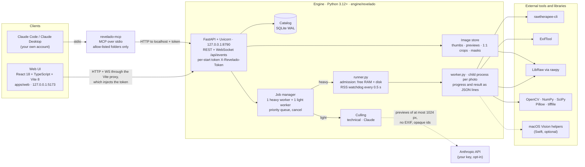
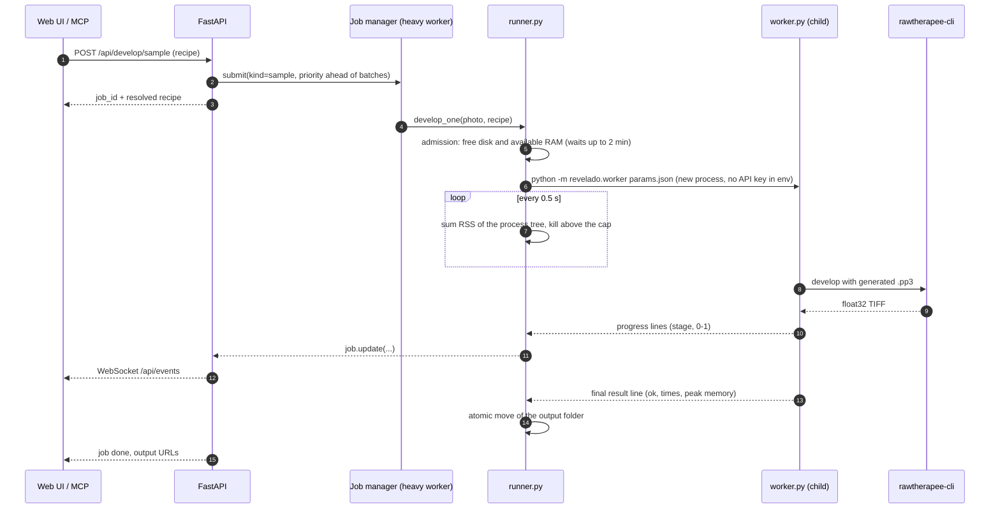
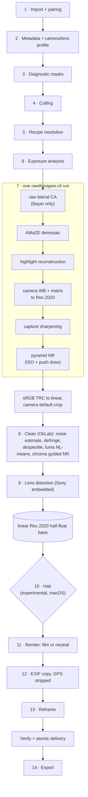
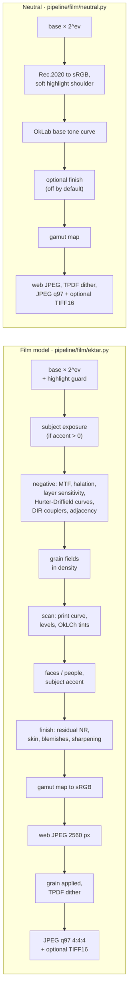
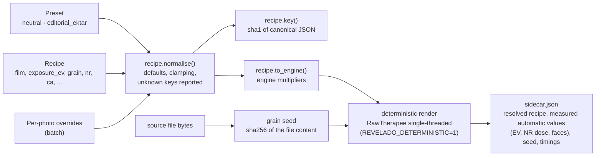

# Architecture overview

> **Resumen (ES).** Revelado tiene tres piezas:
>
> - un **motor** en Python que escucha solo en `127.0.0.1` y hace todo el trabajo de imagen;
> - una **interfaz web** (React + Vite);
> - un **servidor MCP** opcional para usarlo desde Claude Code o Claude Desktop.
>
> Solo corre un trabajo pesado a la vez, y cada foto se revela en su propio proceso, vigilado por un control de memoria. Todo ajuste es una receta, y la misma receta da los mismos píxeles. Los diagramas de abajo siguen el orden real del código.

This page describes the system as it is in **0.2.0-beta.1** (from source). Every box maps to a file in the repository. For the per-stage algorithms see the [technical deep-dive](technical/index.md); for measured numbers see [BENCHMARKS.md](technical/BENCHMARKS.md).

## 1. Components

| Part | Path | Technology | Responsibility |
|---|---|---|---|
| HTTP API | [`engine/revelado/api/app.py`](../engine/revelado/api/app.py) | FastAPI, Uvicorn (1 worker) | 28 REST routes + `/api/events` WebSocket; token middleware; localhost-only CORS; serves the built web app |
| Library and catalog | [`library.py`](../engine/revelado/library.py), [`catalog.py`](../engine/revelado/catalog.py), [`metadata.py`](../engine/revelado/metadata.py) | SQLite (WAL), ExifTool | Folder scan, RAW + JPG pairing, metadata, ratings, cull results, outputs; survives restarts |
| Image store and diagnostics | [`imaging.py`](../engine/revelado/imaging.py), [`diagnostics.py`](../engine/revelado/diagnostics.py) | rawpy/LibRaw, Pillow, OpenCV | Thumbnails, previews (camera JPG → embedded JPEG → quick render), 1:1 crops, noise / CA / shading masks |
| Profiles | [`profiles/`](../engine/revelado/profiles/__init__.py) | JSON seed DB | Camera and lens resolution with per-field provenance; develop recommendations |
| Job manager | [`jobs.py`](../engine/revelado/jobs.py) | threads, priority queues | 1 heavy + 1 light worker, priorities, cancellation, event bus to the WebSocket |
| Culling | [`cull/technical.py`](../engine/revelado/cull/technical.py), [`cull/claude.py`](../engine/revelado/cull/claude.py) | OpenCV, optional Anthropic SDK | Local technical score; opt-in two-stage AI cull |
| Develop orchestration | [`develop.py`](../engine/revelado/develop.py), [`runner.py`](../engine/revelado/runner.py) | subprocess, psutil | Sample / batch / export jobs, admission control, watchdog, atomic placement of outputs |
| Develop worker | [`worker.py`](../engine/revelado/worker.py), [`pipeline/`](../engine/revelado/pipeline) | RawTherapee, NumPy, OpenCV, tifffile | One photo end to end in an isolated child process |
| Recipes | [`recipe.py`](../engine/revelado/recipe.py) | Python | Schema, presets, validation, mapping to engine parameters |
| Web UI | [`apps/web/`](../apps/web) | React 18, TypeScript 5, Vite 8 | Screens: Onboarding, Library, Viewer, Cull, Develop, Oven, Films, Settings, Guide |
| MCP server and plugin | [`mcp/`](../mcp), [`.claude-plugin/`](../.claude-plugin) | official `mcp` SDK, httpx | 17 tools over stdio; Claude Code plugin with 3 skills; `.mcpb` bundle for Claude Desktop |

## 2. Process and threading model

- **Heavy worker (exactly 1):** develop sample, batch and export. A sample jumps ahead of heavy jobs that are still queued (priority 1 vs 5) but never interrupts the running job; a batch that has already started runs to the end first.
- **Light worker (exactly 1):** technical cull and Claude cull.
- **Child process per photo:** a fresh Python interpreter started with `subprocess` (not a `multiprocessing` fork of the engine), so behaviour is the same on macOS, Windows and Linux. When it exits, every full-resolution buffer is gone.
- **Admission and watchdog:** at least `REVELADO_HEAVY_MIN_AVAILABLE_GB` (3.5) of available RAM and `REVELADO_MIN_FREE_DISK_GB` (6) of free disk; the tree is killed above `REVELADO_HEAVY_RSS_CAP_GB` (9) with `E_MEM_GUARD`. A failed item is recorded and the batch continues. A low-memory retry is planned, not implemented ([memory and scheduling](technical/memory-scheduling.md)).

## 3. Pipeline order

The real order, from import to export. Steps 6–13 run inside the child process ([`worker.py`](../engine/revelado/worker.py)).

### Inside the render (step 11)

Design rules visible in the order:

- **Each defect is corrected once, at the right stage.** Lateral CA on the mosaic, axial fringes before chroma NR, distortion on the linear base.
- **Grain is the last pixel operation of the render**, after retouch and sharpening, so it covers skin and background evenly.
- **Reframing works on encoded outputs** and gives the JPG, the web JPEG and the 16-bit TIFF exactly the same rotation and crop.

## 4. Recipes and determinism

The recipe key identifies outputs in the catalog, so an export can reuse an output developed with the same recipe. Details: [determinism and recipes](technical/determinism-and-recipes.md).

## 5. Data and storage

| What | Where | Notes |
|---|---|---|
| Originals | your folder | Revelado reads them; ratings and results go to the catalog, and export refuses to write inside this folder |
| Catalog | `<cache>/catalog.sqlite` | SQLite in WAL mode; `session_id = sha1(folder)[:12]`, `photo_id = sha1(session + stem)[:16]` |
| Thumbnails, previews, masks, swatches | `<cache>/thumbs`, `previews`, `masks`, `swatches` | Regenerable |
| Developed outputs | `<cache>/develop/<photo_id>/<output_id>/` | `full.jpg`, `web.jpg`, optional `full.tif`, `sidecar.json`; job logs in `<cache>/develop/<photo_id>/logs/` |
| Downloaded models | `<cache>/models` | YuNet / Haar, sha256-pinned; `REVELADO_OFFLINE=1` disables downloads |
| Runtime token | `engine/.runtime_token` and the per-user state folder | Mode 0600, new at each start |

`<cache>` is `REVELADO_CACHE_DIR` (default `<repo>/cache`, gitignored). Settings come from package defaults, then `engine/.env`, then `REVELADO_*` environment variables ([`config.py`](../engine/revelado/config.py)).

## 6. Security boundaries

- The engine binds only to `127.0.0.1`, `localhost` or `::1`; any other host is refused at start-up.
- Every route except the static web app requires the per-start token (`X-Revelado-Token` header or `?token=`), compared in constant time. CORS accepts only localhost origins.
- The develop child never receives `ANTHROPIC_API_KEY`. The key is never stored on the settings object.
- The AI cull is opt-in per request and needs both a key and `allow_cloud: true`. It sends re-encoded JPEG previews without EXIF, identified by opaque ids.
- The MCP server only opens allow-listed photo folders, only exports to allow-listed export folders and only talks to engine URLs on this machine.

See [SECURITY.md](../SECURITY.md) for the threat model and reporting.

## 7. Principles

- **Local first.** No telemetry and no account. AI features are opt-in, run on the user's own key or the user's own Claude client, and only receive downscaled, EXIF-stripped previews.
- **One heavy job per machine**, a child process per photo, and a memory watchdog.
- **Everything is a recipe.** Data, never code, with deterministic results.
- **Film stocks are data.** Profiles will be fitted from the user's own scans, locally.
- **Honest limits.** Experimental stages are off by default and labelled; numbers are published only when measured on public fixtures.

## 8. Where it is going

The target desktop app wraps the same engine in a **Tauri 2** shell. The engine runs as a sidecar and talks JSON-RPC over stdio, so there is no network listener at all. The app ships as signed installers for macOS, Windows and Linux. The HTTP API above is the current interface and will be kept for development and for the MCP server.
