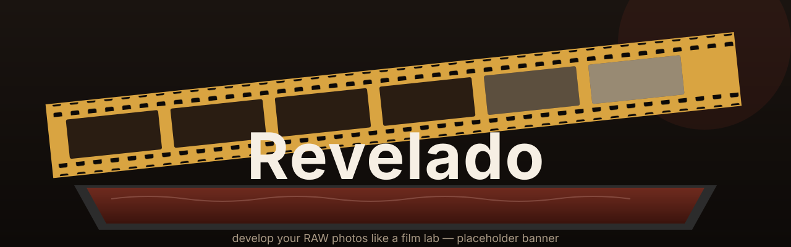

# Revelado

**Revelado: develop your RAW photos like a film lab.** Physical film emulation, honest noise and chromatic-aberration cleanup, local culling, and optional AI help, all running on your own computer.

- [User manual](en/manual/index.md) · [Manual en español](es/manual/index.md)
- [Technical deep-dive](technical/index.md): why the noise reduction, CA correction and film model work
- [Architecture](ARCHITECTURE.md)
- [Source code on GitHub](https://github.com/Blue-Studio-Lab/Revelado)

Created by Jorge Luis Peña Sanchez · Co-created with Claude (Anthropic) · GPL-3.0-or-later
