# The film model: negative, print/scan, grain

> **Resumen (ES).** Revelado no aplica una LUT: simula la película paso a paso. La luz de la escena expone tres capas (roja, verde y azul), cada una con su curva de densidad (pie, recta y hombro). Las capas se influyen entre sí (acopladores DIR). El revelado crea bordes de adyacencia y el grano nace *en la densidad del negativo*, como en la realidad. Después un "escáner" convierte esas densidades en una imagen positiva, con su curva, sus niveles automáticos y su nitidez. Como el grano vive en la densidad, el escáner lo comprime él solo en las altas luces y en el negro profundo: no hay que "protegerlo" a mano.

Source: [`engine/revelado/pipeline/film/ektar.py`](../../engine/revelado/pipeline/film/ektar.py), the physical renderer. Per-stock values live in profile data ([`pipeline/data/`](../../engine/revelado/pipeline/data)), never in code.

## Provenance of the Ektar-inspired profile

> **Procedencia (ES).** El perfil `kodak_ektar_100` es una emulación aproximada *inspirada en* Ektar 100. Sus valores se derivaron de seis imágenes de referencia públicas (escaneos de terceros; las imágenes no se incluyen en el repositorio) y de la hoja técnica publicada por Kodak. No es un producto de Kodak ni está afiliado, patrocinado o respaldado por Kodak.

The bundled spec [`kodak_ektar_100.json`](../../engine/revelado/pipeline/data/kodak_ektar_100.json) is an **approximate, Ektar 100-inspired emulation**. Its values were measured from six publicly viewable reference images (third-party film scans; the images themselves are not in the repository and are not redistributed) and from the film datasheet Kodak publishes. It does not reproduce any proprietary data or software. The internal id `kodak_ektar_100` and the preset name `editorial_ektar` are descriptive identifiers only.

Kodak and Ektar are trademarks of their respective owners. Revelado is not affiliated with, sponsored by or endorsed by Kodak. A future version will let you fit profiles from your own scans instead (see the end of this page).

```mermaid
flowchart LR
  E["scene-linear Rec.2020<br/>× 2^ev"] --> M["film MTF<br/>+ halation"]
  M --> S["layer sensitivity<br/>3×3, rows sum to 1"]
  S --> H["H&D curves per layer<br/>log10 E → density"]
  H --> DIR["DIR couplers<br/>(density domain)"]
  DIR --> A["adjacency effect<br/>(density domain)"]
  A --> G["grain field<br/>(density domain)"]
  G --> SC["scanner: print curve,<br/>channel mix, auto levels"]
  SC --> R["rendition (OkLCh):<br/>scan tints, skin, gamut"]
  R --> O["dither + encode"]
```

## 1. Exposure, MTF and halation

- **Exposure.** The scene-linear base is multiplied by $2^{ev}$ (see [exposure](exposure-log-profiles.md)), with a guard that keeps the 99.8th percentile ≤ +4.5 EV over grey.
- **Film MTF.** A Gaussian blur of σ = 0.55 px at the reference scale stands in for the emulsion's limited resolution. The *reference scale* is a 36 mm frame sampled at 5.14 µm per pixel, which gives a 7008 px long side. Every spatial size in the model is defined at that scale and multiplied by `scale = long_side / 7008`, so a 24 MP file and a 61 MP file get physically equivalent grain and blur.
- **Halation.** Light passes through the emulsion, reflects off the film base and re-exposes mostly the red layer, as a wide halo around very bright sources. The model uses
  $$E \mathrel{+}= s_h\,\big(0.7\,G_{r_1} + 0.3\,G_{r_2}\big) * \max(Y - Y_t,\,0)\;\cdot\;\mathbf{c}_h$$
  with threshold $Y_t = 2.0$ (≈ +3.5 EV), radii 22 px and 60 px, a weak strength and a red-orange colour $\mathbf{c}_h$. Stocks with an anti-halation layer get an almost invisible amount. It is computed at ¼ resolution, because it is a wide, low-frequency halo.

## 2. Layer sensitivity

A 3×3 matrix $M_c$ maps Rec.2020 to the exposures of the R, G and B sensitive layers. Each row sums to 1, so **neutral greys stay neutral**: only colour separation changes. The matrix comes from the profile data.

## 3. Characteristic (H&D) curves

Each layer turns log exposure $u = \log_{10}(E/0.18)$ into density above base fog. The curve has a soft toe and a distant shoulder, built from two softplus functions:

$$
D_c(u) = \gamma_c\Big[s_t\,\operatorname{softplus}\!\Big(\tfrac{u - u_{t,c}}{s_t}\Big) - s_s\,\operatorname{softplus}\!\Big(\tfrac{u - u_{s}}{s_s}\Big)\Big]
$$

The curve is shifted so all three layers agree at mid-grey ($u = 0$), as a scanner would balance them. Typical colour-negative values are γ ≈ 0.6–0.65, a toe about 1.6 log units below grey and a shoulder more than 2 log units above it, which gives the famous over-exposure latitude. Small per-layer differences in $\gamma_c$ and $u_{t,c}$ create **physical colour crosstalk**: for example, a slightly higher toe in the red layer leaves deep shadows a touch cyan/teal, while mid-tones stay neutral.

## 4. DIR couplers (inter-image effects)

Development-inhibitor-releasing couplers make each layer's development hold back the others. This is the main reason colour negatives look *saturated but natural*. The model applies the effect **in density**, with a matrix whose rows sum to 1:

$$
\mathbf{d}' = M_d\,\mathbf{d}, \qquad M_d = \begin{pmatrix}1+2k & -k & -k\\ -k & 1+2k & -k\\ -k & -k & 1+2k\end{pmatrix}, \quad k \approx 0.08
$$

Greys ($d_R = d_G = d_B$) are unchanged. Colour differences are amplified by $(1 + 3k)$.

## 5. Adjacency (Eberhard/Mackie) effect

Near an edge, fresh developer from the low-density side speeds up development on the high-density side, and exhausted developer slows it down on the other. The result is the crisp "acutance" of film, without the halos of digital sharpening. The model implements it as an unsharp mask **in density**, with a soft threshold so grain-level variations are not boosted:

$$
\Delta = d - G_{1.4} * d,\qquad d \mathrel{+}= 0.30\;\Delta\;\operatorname{smoothstep}(0,\,2\tau,\,|\Delta|)
$$

## 6. Grain: synthesised in density space

Real grain is the random placement of **dye clouds**. More exposure means more developed clouds and more density, so in the negative the grain *variance grows with density*: it is shot noise.

Each layer is modelled as two sub-layers:

- a **fast** one with large clouds (σ ≈ 1.3–1.5 px), which saturates early: $d_f = d_{\max,f}\,(1 - e^{-d/d_{\max,f}})$;
- a **slow** one with fine clouds (σ ≈ 0.55–0.65 px), which holds the rest: $d_s = d - d_f$.

Each sub-layer is filtered white noise $n = G_\sigma * \mathcal N(0,1)$, normalised to unit variance. The two are combined with weights proportional to $\sqrt{\text{fraction of density}}$, so their variances add up to the layer's density:

$$
g_c = \frac{w_f\,n_f + w_s\,n_s}{\sqrt{w_f^2 + w_s^2}}, \qquad w_f \propto \sqrt{d_f/d},\; w_s \propto \sqrt{d_s/d}
$$

Then:

- a mild non-linearity $\operatorname{sign}(g)\,|g|^{0.9}$ (clouds are discrete, not Gaussian);
- a low-frequency **clumping** field (σ ≈ 7 px, ±22 %);
- a fog density term, so even unexposed film has grain;
- a scanner merge that pulls most of the colour grain into luminance (chroma fraction ≈ 0.05 for a Frontier-style scan).

**Why this matters.** The grain field is added to *density* before the scan. The scanner curve is flat in the shoulder (highlights) and in the toe (deep blacks), so it compresses the grain there by itself, exactly as on real film. Hand-made "protect the highlights" masks are not needed. The grain is also the **last pixel operation** in the pipeline. Nothing resamples, sharpens or denoises it afterwards.

## 7. The scanner: density → positive

1. **Print curve.** A lookup table maps neutral density to an output code. It is built by inverting the neutral negative curve against the stock's target tone curve, which has a long shoulder and never reaches pure white. Because of this construction, a neutral grey going through *negative + scanner* lands exactly on the target tone curve.
2. **Channel mix.** A purely per-channel scan is physically correct but rotates hues strongly. The model mixes the per-channel result with a **ratio-preserving** one:
   $$\text{lin} = m\cdot P(d_c) + (1-m)\cdot P(\bar d)\cdot 10^{(d_c - \bar d)/\gamma}, \qquad m \approx 0.55$$
3. **Auto levels per frame**, as a lab operator would set them:
   - a black point subtracts flare/fog softly ($x - b$ with a smooth toe, never negative), so blacks are deep but never crushed;
   - a white gain $g\,x/(1 + (g-1)x^2)$ lifts dull, overcast frames toward clean whites, without clipping.
4. **Rendition** in OkLCh: per-hue saturation and hue shifts of the scan (16 bands), skin handling, a light split tone, highlight desaturation, chroma compression, then gamut mapping to sRGB (chroma is reduced at constant L and h).
5. **Output.** sRGB 8-bit with TPDF dither and JPEG q97 4:4:4, or 16-bit TIFF.

## 8. Profiles and your own scans

The renderer is code. A film stock is **data**: curves, matrices, grain parameters and rendition bands. Revelado will ship tools that **fit a profile from your own scans on your machine** (planned for v0.2). Scans never leave the disk, and profiles derived from third-party scans are not published without permission.

## 9. Results

| Metric | Value |
|---|---|
| Neutral ramp: max deviation from the target tone curve (8-bit codes) | not yet measured |
| Neutral ramp: max chroma introduced (must be ≈ 0 in mid-tones) | not yet measured |
| Grain σ vs output level: peak / highlights / deep black (codes) | not yet measured |
| Grain autocorrelation at 1 px / 2 px | not yet measured |
| Render time, `editorial_ektar` preset (film + retouch + web JPEG + TIFF16) | 32.49 s at 32.7 MP · 10.75 s at 12.0 MP (24 MP not measured) |

Render times from `scripts/benchmark_quality.py` on Apple Silicon, 16 GB; results vary. The per-step breakdown (negative, grain, scan, colour, retouch, encode) is in [BENCHMARKS.md](BENCHMARKS.md#3-performance-and-memory).
