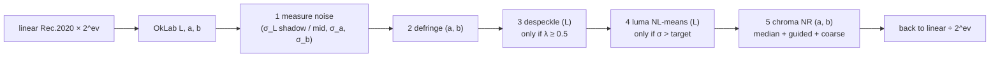

# Noise reduction: why it works so well

> **Resumen (ES).** Revelado no "difumina" el ruido: primero **mide** cuánto ruido hay (por ISO, por el empuje de exposición que va a aplicar y midiendo la propia imagen), y luego reparte el trabajo. Separa luminancia (L) y color (a, b) en OkLab. El color se limpia fuerte y a varias escalas con filtros que siguen los bordes de luminancia. La luminancia se limpia solo lo justo para llegar a un objetivo, conservando parte de la textura original. Los puntos sueltos se quitan solo cuando el ruido es alto. Resultado: sombras neutras, sin motas de color y sin aspecto plástico.

Source: [`engine/revelado/pipeline/raw.py`](../../engine/revelado/pipeline/raw.py) (dosing and the RawTherapee stage) and [`engine/revelado/pipeline/clean.py`](../../engine/revelado/pipeline/clean.py) (the OkLab clean stage).

## 1. The problem

Event and documentary photographers often shoot in a log picture profile (for example S-Log3) or underexpose to protect highlights. The RAW is then **pushed** by 1–3 EV when developed. Every stop of push doubles the visible noise amplitude, on top of what the ISO already brings. A denoiser that only looks at ISO under-cleans these files. One that treats every file the same way over-cleans the clean ones.

Two observations drive the design:

1. **Colour noise and luminance noise are different problems.** People see fine detail mainly in luminance. The visual system's resolution for chroma is several times lower. Chroma noise, the blotchy magenta/green mottle, is ugly and carries almost no real detail at high frequency. Luminance noise is partly *texture*: skin pores, fabric weave, foliage.
2. **The amount of noise is knowable before you start.** It follows from the sensor (ISO), the planned exposure push, and a quick measurement on the image itself.

## 2. Dosing: how much noise to expect

The planned exposure correction `ev` comes from [exposure analysis](exposure-log-profiles.md). The effective noise is expressed in *stops above ISO 100*:

$$
s = \log_2\!\left(\frac{\max(\mathrm{ISO},\,50)}{100}\right) + \max(0,\; ev - 1.5)
$$

The first 1.5 EV of push are "free", because that is the normal correction for a log-profile capture. Every stop beyond that counts like one more stop of ISO. The **cleaning level** is

$$
\lambda = \operatorname{clip}\!\left(\frac{s - 3}{5},\; 0,\; 1\right)
$$

so ISO 100–800 with a normal push (≤ 1.5 EV) gives λ = 0 (barely touched), and λ reaches 1 at s = 8, for example ISO 1600 with a +5.5 EV push or ISO 25600 with a normal push. Both high-ISO benchmark files land there (s = 8.53 and 8.32, λ = 1; see [BENCHMARKS.md](BENCHMARKS.md#1-noise-reduction)). Every radius and strength below is a function of λ or of the *measured* noise, never a fixed number.

## 3. Stage A: pyramid NR in the RAW developer

The first pass runs inside RawTherapee, during the neutral, scene-referred develop: AMaZE demosaic, linear Rec.2020, no tone curve. That is the earliest point where noise is still close to its raw statistics:

| Parameter | Formula | Why |
|---|---|---|
| Luminance (wavelet pyramid) | $\operatorname{clip}(6(s-3),\,0,\,40)$ | zero at low noise, so real texture is not smoothed |
| Luminance detail | $\operatorname{clip}(80 - 0.5\cdot\text{luma},\,60,\,80)$ | keep fine texture as the strength rises |
| Chrominance | automatic (RawTherapee "AUT"), base $\operatorname{clip}(15+25\lambda,\,15,\,40)$ | colour can be cleaned hard |
| Capture-sharpening contrast threshold | auto if λ < 0.4, else $15 + 25(\lambda-0.4)/0.6$ | do not "sharpen" the noise |

## 4. Stage B: the OkLab clean stage

After RawTherapee, the image is converted back to exact linear light. It is **exposed** ($x = \text{base}\cdot 2^{ev}$, so mid-grey sits near 0.18 the way the viewer will see it) and converted to **OkLab**, where L is close to perceived lightness and a, b are opponent colour axes. Each step below touches L **or** a/b, never both by accident.

### 4.1 Measuring the noise on the image itself

The image is split into 64 px tiles. The tiles kept for measurement are those whose smoothed-L gradient is in the **lowest 20 %**, with lightness between 0.12 and 0.9. These are flat regions, where any variation is noise rather than detail. In each kept tile, for each channel *c*:

$$
r = c - \operatorname{box}_{3\times3}(c), \qquad
\hat\sigma = \frac{1.4826 \cdot \operatorname{median}\lvert r - \operatorname{median}(r)\rvert}{\sqrt{8/9}}
$$

- 1.4826 · MAD is a robust estimate of a Gaussian σ: outliers and the odd edge do not inflate it.
- The residual of a 3×3 mean keeps a variance of $\sigma^2(1-1/9)$, hence the correction $\sqrt{8/9} \approx 0.9428$.
- The tile median is reported in OkLab units ×100.

Luminance noise is also measured separately in **shadows** (L 0.10–0.40) and **mid-tones** (L 0.40–0.90). A pushed file is much noisier in the shadows, and the luma step uses both values.

### 4.2 Despeckle (only at high noise)

When λ ≥ 0.5, high ISO plus a strong push leaves isolated salt-and-pepper pixels in L. A pixel is replaced by its 3×3 median only when **both** of these hold:

$$
L > \max_{8}(L) + t \;\;\lor\;\; L < \min_{8}(L) - t, \qquad t = 5\,\sigma_{L,\text{shadow}}
$$

$$
\text{and} \quad \operatorname{sd}_{5\times5}(L) < 0.6\,t + 0.5\,\lvert L - \mu_{5\times5}\rvert
$$

The first condition finds pixels that escape the range of all eight neighbours. The second limits the replacement to *smooth* surroundings. Lines, eyelashes, highlights on water and denim weave always have similar neighbours or a busy neighbourhood, so they are never touched. At low λ the step is skipped entirely: there, a lone bright pixel is more likely real.

### 4.3 Luma: non-local means toward a *target*, not to zero

Luma is denoised only if the measured noise exceeds the target $T = 0.45$ (OkLab L ×100) by more than 10 %. NL-means runs on L with strength $h = \min(4,\; 1.15\,\sigma_{\max})$. The result is then **blended back** with the original, pixel by pixel:

$$
L' = L_d + m\,(L - L_d), \qquad m = \operatorname{clip}\!\left(\frac{T}{\sigma(L)},\; 0.3,\; 1\right)
$$

Here $\sigma(L)$ moves smoothly from the shadow estimate to the mid-tone estimate as blurred L goes from 0.25 to 0.55. If $L_d$ is close to noise-free, the residual noise of $L'$ is about $m\,\sigma(L) = T$. Every tone ends up at the **same, chosen** noise level, and it is never cleaner than the target. That is why skin does not turn plastic. The floor of 0.3 means that at least 30 % of the original micro-texture always survives.

### 4.4 Chroma: three scales, never across edges

Chroma noise appears at three scales: single-pixel specks, small mottle and broad low-frequency blotches. Each scale gets its own tool:

1. **Median** 3×3 (5×5 if $\sigma_c > 0.12$ or λ > 0.5) on a and b removes impulsive specks.
2. **Guided filter** on (a, b) with **L as the guide**, radius $r_1 = \operatorname{round}(4 + 8\lambda)$ and regularisation
   $$\varepsilon_1 = \big((2.5 + 3\lambda)\,\sigma_L\big)^2 + 2\cdot10^{-6}$$
   The guided filter models the output locally as a linear function of the guide, $q = a\,L + b$. Colour that changes *together with* a luminance edge, such as a lock of hair or a printed pattern, is kept. Colour that changes *without* any luminance structure is noise and is averaged away. Tying ε to the luma noise $\sigma_L$ stops the filter from copying luma noise into the colour. This is also why luma is cleaned **first**: the guide is already clean.
3. **Isoluminant colour edges.** Picture a blue jacket against a pink dress of the same brightness: the guide shows no edge there, so a large radius would bleed colour across. A colour-edge map protects these places:
   $$c_e = \lVert\nabla a_p\rVert + \lVert\nabla b_p\rVert, \quad t_1 = \max(0.010,\; 4\cdot\operatorname{median}(c_e)), \quad w = \operatorname{smoothstep}(t_1,\, 2.5\,t_1)$$
   The map is dilated by $r_1$ and blurred, and inside it the result is swapped for a radius-2 guided filter.
4. **Coarse scale** (λ > 0.2): at ¼ resolution, a joint bilateral filter with joint image $[L, 2a, 2b]$ removes broad blotches without crossing colour or luminance edges. Its correction is upsampled and mixed in with weight $\operatorname{clip}((\lambda-0.2)/0.5,\,0,\,1)$.

L is not modified in this step.

## 5. Why the result looks natural

- **Measured, not assumed.** Two files at the same ISO but with different pushes get different treatment, and so do two cameras with different read noise.
- **Separation of concerns.** Most of the cleaning happens in chroma, where the eye has little resolution. Luma is cleaned only to a target, so texture survives.
- **Edge-aware in the right space.** Every spatial filter on colour is guided by luminance and protected at isoluminant colour edges, so no colour halos appear.
- **Order matters.** Defringe runs before chroma NR, so fringes are not smeared into wider halos. Luma runs before chroma, so the guide is clean.
- **Nothing is hidden by grain.** Film grain is added *after* cleaning and is synthesised (see [film model](film-model.md)), so it does not have to cover up residual sensor noise.

## 6. Measured results

All numbers come from `scripts/benchmark_quality.py` on **public CC0 fixtures**, never on client photos. Machine, method and raw output are in [BENCHMARKS.md](BENCHMARKS.md) (Apple Silicon, 16 GB, RawTherapee 5.13; results vary). Each file is developed with `nr=off` and `nr=auto`; σ is measured on the same 16 flattest patches (L 0.08–0.62) of the exposed base. RawTherapee's automatic chroma denoise is on in both runs, so the figures show the extra effect of the `auto` dose.

| Metric | Sony ILME-FX3, ISO 20000 | Canon EOS R50, ISO 32000 |
|---|---|---|
| Luma σ in flat shadow/mid patches, off → auto (OkLab ×100) | 3.772 → 0.867 (−77.0 %) | 10.826 → 5.197 (−52.0 %) |
| Chroma σ $\sqrt{\sigma_a^2+\sigma_b^2}$, off → auto (OkLab ×100) | 0.935 → 0.031 | 6.561 → 0.421 |
| Texture retained (high-frequency energy on textured tiles, after/before) | not yet measured | not yet measured |
| Time for the clean stage alone at 24 MP | not yet measured | not yet measured |

The whole develop stage (RawTherapee + clean + distortion) took 6.68 s on the 12 MP ILME-FX3 file in the neutral performance run.

## 7. Limits

- The measurement needs some flat areas. A frame that is texture from edge to edge (foliage, crowds) falls back to the flattest 15 % of the image and can over-estimate the noise slightly.
- The thresholds for the purple/green fringe windows and the target $T$ were tuned on one camera system (a full-frame Sony sensor). Other cameras use the same model, but their calibration is still being collected; contributions are welcome.
